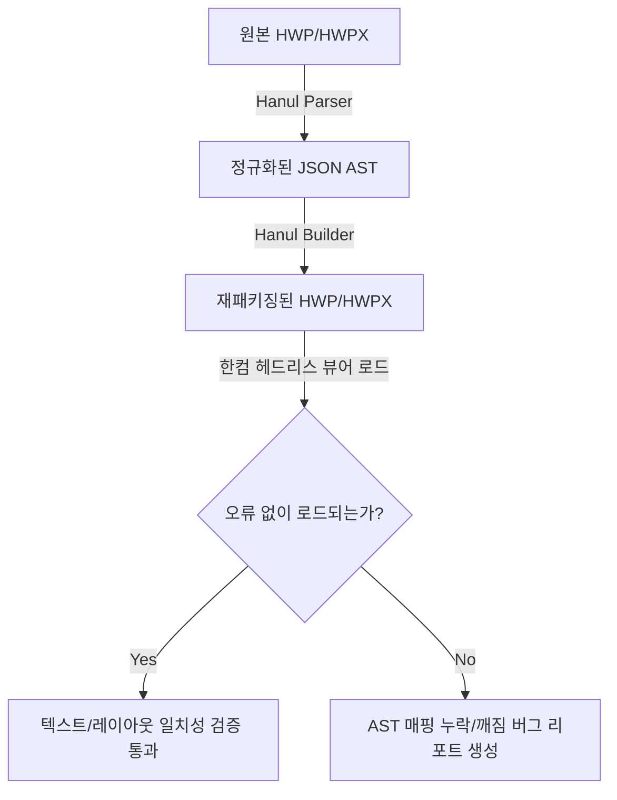

# 🌲 AST 변환 에이전트 (Document Model Mapper)

> **에이전트 역할**:  
> 복원된 HWP/HWPX 바이너리 레코드 데이터를 현대적인 웹/데스크톱 에디터와 AI 에이전트가 손쉽게 다룰 수 있는 **표준 JSON / 블록 트리 구조(AST - Abstract Syntax Tree)**로 정규화 매핑하고, 양방향(Round-trip) 변환 무결성을 검증합니다.

---

## 🛠️ 연동 도구 및 기술 스택

- **에디터 스키마 모델**: ProseMirror Schema, TipTap Block Tree, Slate JSON Model
- **문서 표준**: KS X 6101 HWPX (OWPML) DOM, Markdown CommonMark AST (mdast)
- **라운드트립 자동화**: 한컴 헤드리스 CLI / PDF 변환 드라이버, Playwright 헤드리스 검증

---

## 🎯 세부 임무 및 동작 메커니즘

### 1. 한글 고유 조판 규칙의 1:1 AST 정규화 매핑
한글 문서 고유의 특수한 조판 메커니즘을 현대적 블록/인라인 노드로 손실 없이 치환합니다:

| 한컴 고유 조판 개념 | AST 대응 노드 (ProseMirror / TipTap) | 비고 |
|---|---|---|
| **문단 및 런 (Para & Run)** | `paragraph` 블록 + `text` 인라인 노드 (Marks: `bold`, `color` 등) | 서식 정보 분리 |
| **글자처럼 취급 (Treat as Char)** | `inline_table`, `inline_image` 속성 플래그 | 문단 내 인라인 블록 배치 |
| **문단 내 강제 줄바꿈 (Shift+Enter)** | `hard_break` 노드 | 일반 엔터(`paragraph` 분리)와 구분 |
| **다단 (Multi-column)** | `column_group` 및 `column` 래퍼 노드 | 단 너비 및 단 구분선 속성 |
| **수식 (Equation Script)** | `equation` 노드 (`script`: 한글 수식 텍스트, `latex`: 변환 수식) | LaTeX 상호 호환 지원 |
| **표 및 셀 병합 (Table & Merge)** | `table`, `table_row`, `table_cell` (속성: `colspan`, `rowspan`) | 셀 너비 비율 보존 |

### 2. 표준 AST JSON 스키마 예시
```json
{
  "type": "doc",
  "content": [
    {
      "type": "paragraph",
      "attrs": { "align": "center" },
      "content": [
        {
          "type": "text",
          "text": "2026년 공공 사업 보고서",
          "marks": [{ "type": "bold" }, { "type": "fontSize", "attrs": { "size": 16 } }]
        }
      ]
    },
    {
      "type": "table",
      "attrs": { "rows": 2, "cols": 2, "treatAsChar": true },
      "content": [ ... ]
    }
  ]
}
```

### 3. 헤드리스 라운드트립 자동 검증 (Round-trip Verification)


---

## ⚠️ AST 변환 시 필수 원칙
1. **양방향 손실 금지**: AST로 변환했다가 다시 HWP/HWPX로 패키징할 때, 에디터가 지원하지 않는 확장 속성(워터마크, 미세 선 스타일, 캡션 번호 매기기 등)은 `attrs.rawExtension` 슬롯에 원본 바이트/XML을 보존해야 합니다.
2. **AI 최적화 구조**: MCP 서버에서 AI가 문서를 조회할 때 복잡한 바이너리 대신 이 JSON AST를 직접 탐색하고 변경할 수 있도록 직관적인 헬퍼 인터페이스를 제공합니다.
