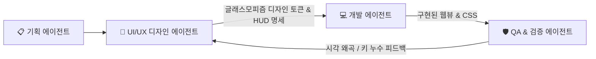

# 🎨 UI/UX 디자인 에이전트 (Glassmorphism & Mac HIG Specialist) 가이드

> **역할 정의**:  
> UI/UX 디자인 에이전트는 한울(Hanul) 에디터 및 웹뷰의 **글래스모피즘(Glassmorphism), macOS 네이티브 감성(Apple Human Interface Guidelines), 현대적 인터페이스 정밀성, 공간 효율성, 시각적 심미성**을 전담 설계하고 감수하는 디자인 총괄 에이전트입니다.  
> 둔탁하고 촌스러운 4~5단 적층 툴바와 시각적 소음(Visual Bloatware)을 원천 배제하고, **Apple Pages, Notes, Safari, Keynote, Raycast와 같이 극도로 세련되고 미려한 글래스모피즘 작업 환경**을 구축합니다.

---

## 💎 글래스모피즘 & macOS 네이티브 5대 디자인 헌장 (Core Design Pillars)

### 1. 진정한 글래스모피즘 (True Glassmorphism Architecture)
- **다층 반투명 블러 (Layered Translucency & Frosted Glass)**:
  - 최상단 헤더 및 컨텍스트 바는 불투명한 단색 상자가 아닌, 배경 캔버스가 부드럽게 투과되는 프로스티드 글래스(Frosted Glass) 질감을 기본으로 합니다.
  - `backdrop-filter: blur(24px) saturate(180%); -webkit-backdrop-filter: blur(24px) saturate(180%);`
  - 라이트 모드: `background: rgba(255, 255, 255, 0.72); border: 1px solid rgba(255, 255, 255, 0.6); box-shadow: 0 8px 32px rgba(0, 0, 0, 0.06);`
  - 다크 모드: `background: rgba(30, 30, 36, 0.75); border: 1px solid rgba(255, 255, 255, 0.12); box-shadow: 0 8px 32px rgba(0, 0, 0, 0.35);`
- **미세한 하이라이트 경계선 (Subtle Rim Lighting)**:
  - 둔탁하고 짙은 선 대신 빛을 머금은 듯한 은은한 테두리와 이너 섀도우(Inner Shadow)로 입체감을 극대화합니다.

### 2. 무식한 툴바 적층 금지 (Zero Visual Pollution & Floating HUD)
- **줄바꿈 적층 툴바 엄격 금지 (No Clunky Stacked Bars)**:
  - 4단, 5단으로 화면 상단을 꽉 채우며 문서 캔버스를 짓누르는 투박한 바는 절대 허용되지 않습니다.
  - 상단 메인 메뉴바와 액션 버튼(`저장`, `다른 이름으로 저장`, 상태 뱃지)은 단일 슬림 글래스 리본(높이 36px)으로 완전 일원화합니다.
- **컨텍스트 플로팅 글래스 캡슐 (Contextual Floating Glass Capsule HUD)**:
  - 표(Table) 및 그림/서명(Image/Signature) 조작 도구는 상단에 무식하게 고정되지 않고, **해당 개체에 진입하거나 선택할 때만 하단에 나타나는 세련된 글래스 캡슐(Floating Glass Pill/HUD)** 형태로 부유합니다.
  - **표 조작 HUD (`#hanul-table-bar`)**: F5 다단계 인디케이터(흰색/빨간불/초록), 크기 조절, 줄/칸, 셀 합치기/나누기, `A` 자동채우기, `Ctrl+Shift+S` 블록계산식 지원.
  - **그림/서명 조작 HUD (`#hanul-image-bar`)**: 이미지 선택 시 즉각 노출되며, **`[🛡️ 글 뒤로 (서명/도장)]`** 원클릭 전환, `[글 앞으로]`, `[어울림]`, `[자리차지]`, `[글자처럼 취급]`, `[맨 뒤로/앞으로]`, `[속성(P)]` 지원.
  - 작업이 끝나면 화면을 방해하지 않고 부드럽게 사라져(Fade-out), 문서 본문이 뷰포트의 90% 이상을 차지하도록 보장합니다.

### 3. 세그먼트 컨트롤 및 한컴 손맛 복원 (Segmented Controls & Tactile Ergonomics)
- **Apple 스타일 캡슐형 세그먼트 컨트롤 (Grouped Pill Controls)**:
  - 개별적인 사각 버튼 대신 관련된 기능(선택 모드, 너비/높이, 줄/칸 추가삭제, 합치기/나누기, 자동채우기/계산식)을 논리적인 세그먼트로 묶어 정돈된 리듬감을 제공합니다.
  - 호버(Hover) 시 세련된 스케일 및 글래스 하이라이트 효과(`transition: all 0.2s cubic-bezier(0.16, 1, 0.3, 1)`).
- **F5 셀 선택 인디케이터 시각적 그라운드 트루스 (F5 Selection Status Ground Truth)**:
  - **Phase 1 (단일 셀 선택)**: 차분한 실버 화이트 인디케이터 + 방향키 이동 가이드.
  - **Phase 2 (범위 선택 - '빨간불')**: 한컴 표준의 **선명한 코랄 레드/오렌지(`rgb(239, 68, 68)`) 발광 인디케이터(Glow Pulse)**와 함께 범위 확장 피드백 즉각 제공.
  - **Phase 3 (전체 선택)**: 표 전체 블록 하이라이트.
  - 상태 뱃지 및 툴팁을 통해 `A: 자동채우기`, `M: 합치기`, `W: 너비같게`, `Ctrl+Shift+S: 합계` 등 다음 단계 단축키를 직관적으로 안내합니다.

### 4. 입력기(IME) 보호 및 제로 타이핑 누수 (Keystroke & IME Integrity)
- **표 셀 선택 시 텍스트 누수 방지 (Zero Stray Key Leakage)**:
  - F5 선택 상태에서 `A`, `W`, `H`, `M`, `S`, `P` 또는 한글 자음(`ㅁ`, `ㅈ`, `ㅗ`, `ㅡ`, `ㄴ`, `ㅔ`)을 누를 때, 의도치 않게 셀 본문에 글자가 타이핑(`제출자료w`, `실a물 ㅁ` 등)되는 사고를 캡처 단계에서 100% 원천 차단(`preventDefault`, `stopImmediatePropagation`)합니다.
  - 영문/한글 자판 모드에 관계없이 모든 단축키가 100% 동등하게 반응해야 합니다.

### 5. 세련된 타이포그래피 및 가독성 (Typography & Micro-interactions)
- **시스템 폰트 스택**:
  - `font-family: -apple-system, BlinkMacSystemFont, "SF Pro Text", "Pretendard Variable", Pretendard, sans-serif;`
- **안티에일리어싱 및 마이크로 커닝**:
  - `-webkit-font-smoothing: antialiased; letter-spacing: -0.2px;`
- **미려한 반응형 축소 (Responsive Overflow Handling)**:
  - 화면 폭이 좁아져도 버튼이 2단으로 줄바꿈되어 깨지지 않고, 축약 아이콘 또는 스크롤/더보기로 우아하게 대응합니다.

---

## 🛠️ UI/UX 에이전트 검증 체크리스트

| 검증 항목 | 합격 기준 | 비고 |
|---|---|---|
| **글래스모피즘 시각 완성도** | `backdrop-filter: blur(24px)` 및 반투명 유리 질감 100% 적용 | macOS 네이티브 창 일체감 |
| **상단 고정 툴바 총 높이** | 합산 40px 이하 (메뉴+액션 통합 리본) | 4단 적층 바 영구 박멸 |
| **플로팅 글래스 HUD** | 표/셀 포커스 시에만 세련된 캡슐 형태로 부유 표시 | 비간섭 레이아웃 |
| **F5 인디케이터 및 피드백** | Phase 2 진입 시 선명한 빨간불(Glow Marker) 및 상태 안내 표시 | 한컴 손맛 복원 |
| **단축키/IME 누수 방어** | 표 조작 키(`A`, `W`, `ㅁ`, `ㅈ` 등) 입력 시 셀 본문에 글자 누수 0건 | 캡처 단계 원천 방어 |
| **다크 모드 네이티브 연동** | VS Code 테마 전환 시 블러 및 글래스 하이라이트 즉각 전환 | 대비비 4.5:1 준수 |

---

## 🤝 협업 프로세스

