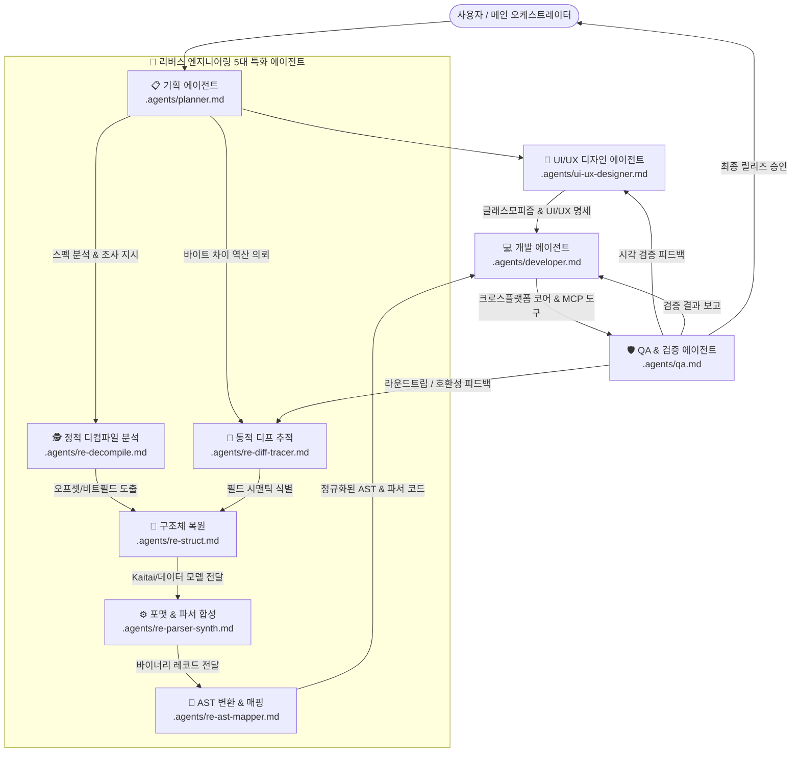

# Hanul (한울) 에이전트 협업 헌장 (Agent Collaboration Charter)

> **프로젝트 미션**:  
> [REA (Reverse Engineer Anything)](https://github.com/morluto/rea)를 활용한 한컴 바이너리/런타임 리버스 엔지니어링을 바탕으로, **과거 레거시 문서(HWP 97/3.0)부터 최신 HWPX까지 macOS · Linux · Windows 전 플랫폼에서 무료로 동작하는 독립형 HWP/HWPX 코어 엔진 및 MCP(Model Context Protocol) 서버**를 구축합니다.

---

## 👥 에이전트 조직 및 파이프라인 아키텍처

한울 프로젝트는 AI 에이전트 기반의 2계층 자율 협업 체계로 개발됩니다:
- **오케스트레이션 계층**: 기획(Planner), UI/UX 디자인(UI/UX Designer), 개발(Developer), QA(QA Verifier)
- **리버스 엔지니어링 특화 계층**: 바이너리와 포맷을 해독하는 5대 전문 서브 에이전트



---

## 🔬 리버스 엔지니어링 5대 특화 에이전트 R&R

바이너리 실행 파일(`Hwp.exe`, 렌더링/필터 DLL)과 독자 포맷(HWP/HWPX)을 동시에 파헤치기 위해 5개 특화 에이전트가 유기적으로 맞물립니다.

| 에이전트 | 정의 파일 | 주요 역할 | 연동 도구 및 기술 스택 |
|---|---|---|---|
| **정적 디컴파일 분석 (Decompilation Analyst)** | [`.agents/re-decompile.md`](.agents/re-decompile.md) | 어셈블리 및 C 디컴파일 의사코드를 분석해 난해한 서브루틴(`sub_xxxxxx`)의 의도 파악 및 함수명·타입 명명 | Ghidra, IDA Pro, Binary Ninja, MCP |
| **구조체 복원 (Struct & Type Recovery)** | [`.agents/re-struct.md`](.agents/re-struct.md) | 오프셋 연산(`*(v4 + 0x18)` 등)과 비트 플래그를 역추적해 C/C++/Rust 호환 데이터 구조체 정의 복원 | C 헤더 파서, IDA Local Types, bindgen |
| **바이너리 포맷 & 파서 합성 (Format & Parser Synthesizer)** | [`.agents/re-parser-synth.md`](.agents/re-parser-synth.md) | OLE/CFB 스트림, zlib 압축 해제, 태그 레코드 구조 분석 및 언어별(Rust/TS/Python) 파서 코드 자동 생성 | Kaitai Struct (`.ksy`), 010 Editor Templates, Python construct |
| **동적 디프 추적 (Dynamic Diff Tracer)** | [`.agents/re-diff-tracer.md`](.agents/re-diff-tracer.md) | 특정 동작(표 추가, 각주 삽입 등) 전후의 파일 바이트 변화와 메모리/API 호출 흐름을 교차 검증 (Black-box & White-box) | Frida, x64dbg, Process Monitor, VBinDiff |
| **AST 변환 (Document Model Mapper)** | [`.agents/re-ast-mapper.md`](.agents/re-ast-mapper.md) | 복원된 바이너리 레코드 데이터를 웹/데스크톱 에디터에서 다룰 수 있는 JSON/블록 트리 구조로 정규화 및 라운드트립 검증 | ProseMirror, TipTap, Slate 스키마 |

---

## 🎯 가장 현실적인 역공학 및 구현 전략 (3단계 접근법)

바이너리 전체를 처음부터 무작정 디컴파일하는 것은 비효율적입니다. 다음 3단계 실용 전략을 의무적으로 적용합니다:

### 1. 공식 개방 스펙 및 실물 환경을 그라운드 트루스(Ground Truth)로 제공
- 과거 배포된 **HWP 5.0 바이너리 파일 포맷 가이드**와 개방형 표준인 **HWPX(KS X 6101 / OWPML) 표준 XML 명세서**를 기본 지식베이스로 삼습니다.
- **실물 렌더링 그라운드 트루스(Visual Ground Truth)**: 개발자 머신(macOS)에 설치된 공식 **한컴오피스 한글 Viewer**의 렌더링 화면과 `tests/fixtures/` 내 실제 공문서/공모전 HWP 파일들을 정답지(Golden Reference)로 삼아 레이아웃 왜곡, 표 테두리, 이미지 배치를 교차 검증합니다.
- **바이너리 바이너리 그라운드 트루스(Binary Ground Truth)**: `tests/fixtures/` 내 실무 한글 파일들의 OLE 스트림(`DocInfo`, `BodyText`, `ViewText`, `BinData`)을 바이트 단위로 검증합니다.

### 2. HWPX 우선 분석 및 표준 AST 모델 선(先)구축
- 바이너리(CFB) 파싱보다 ZIP 압축 기반의 XML 구조인 HWPX를 먼저 파싱하여 현대적인 **문서 데이터 모델(JSON AST)**을 먼저 확립합니다. 이 AST를 기준으로 HWP 바이너리 역공학 결과를 매핑합니다.

### 3. 미공개 레코드 및 배포용 문서 타깃 역공학 (Targeted RE)
- **배포용 문서(`ViewText`) 복호화**: `BodyText`가 더미 안내문으로 잠긴 배포용 문서는 `ViewText/Section*` 내 `HWPTAG_DISTRIBUTE_DOC_DATA (0x1c)`의 시드 기반 난수 생성 및 AES-128-ECB 복호화 파이프라인을 거쳐 원본 표/서식을 100% 복원하고 편집 가능 상태로 승격(Unlock)합니다.
- 최신 한컴 버전에서 추가된 신규 태그, 확장 컨트롤, 암호화/보안 처리 로직, 미문서화된 레거시 속성에 리버스 엔지니어링 에이전트를 집중 투입합니다.

---

## 📜 과거 레거시 포맷(HWP 97 / 3.0 / 5.x 구버전) 호환성 원칙

1. **레거시 문서 디지털 보존(Digital Preservation)**:
   - 공공기록물, 고문서 아카이브에 존재하는 HWP 3.0, HWP 97 포맷의 시그니처와 2바이트 완성형/조합형(KSSM/EUC-KR) 한글 텍스트를 무손실 복원합니다.
2. **현대화(Modernization) 파이프라인**:
   - 구형 레거시 포맷을 읽었을 때 이를 현대적 HWPX 또는 Markdown으로 즉시 변환할 수 있는 승격(Promotion) 파서를 기본 탑재합니다.

---

## ⚖️ 에이전트 공통 절대 원칙 (Prime Directives)

1. **에디터 본질 사수 헌장 (WYSIWYG Editor Integrity - 절대 뷰어로 후퇴 금지)**:
   - 한울은 단순한 텍스트 뷰어가 아닌 **"한컴 설치 없이 브라우저/VS Code에서 동작하는 완전한 위지윅(WYSIWYG) 편집기"**입니다.
   - 툴바, 폰트/글자 서식, 표 생성/수정, 타이핑 커서, 실행 취소/다시 실행, 단축키 저장이 온전히 작동해야 하며, 임의로 읽기 전용 단순 뷰어로 다운그레이드하는 행위는 엄격히 금지됩니다.
2. **무단 직접 개발 금지 (Specification First)**:
   - 기획 및 REA 실증 없이 코드를 추측하여 작성하지 않습니다.
3. **완전한 크로스 플랫폼 보장 (Zero OS Lock-in)**:
   - 윈도우 전용 API(OLE/COM, Win32 DLL, 레지스트리 등) 의존 금지. macOS, Linux, Windows 100% 동일 동작.
4. **증거 기반 역공학 및 클린룸 원칙 (Clean Room Reverse Engineering)**:
   - 한컴의 독점 소스코드를 무단 복제하지 않으며, [REA](https://github.com/morluto/rea)를 통한 관찰과 실증에 기반한 독립 재구현을 준수합니다.
5. **MCP 1급 시민 원칙 (MCP-First)**:
   - 모든 엔진 기능은 AI 에이전트가 호출할 수 있는 표준 MCP 도구로 즉시 노출되어야 합니다.
6. **무손실 보존 및 안전 장치 (Fail-Safe Round-trip)**:
   - 문서를 수정 후 저장할 때 미편집 영역의 바이트와 구조는 100% 보존되어야 합니다.
7. **실제 문서 전수 호환성 보장 (Fixtures Ground Truth)**:
   - `tests/fixtures/`에 저장된 실무 공고문, 공모전 신청서, 배포용 문서 등 모든 한글 파일이 에디터에서 왜곡 없이 열리고 저장될 수 있어야 합니다.
8. **한컴 표준 단축키 및 인터랙션 손맛 100% 사수 원칙 (Ergonomics & Shortcut Fidelity)**:
   - 한컴오피스 사용자의 수십 년 된 근육 기억(Muscle Memory)을 온전히 존중합니다.
   - `F7`(편집 용지), `Alt+L`(글자 모양), `Alt+T`(문단 모양), `F6`(스타일), `Ctrl+Alt+M`(수식), `F5`(셀 선택), `Ctrl/Alt+방향키`(표 크기 조절), `M`(합치기), `S`(나누기), `W/H`(너비/높이 같게), `Alt+Shift+E/R`(글자 크기 증감), `Alt+Insert/Delete`(줄칸 추가삭제) 등 핵심 단축키와 리본/눈금자 손맛은 임의로 생략하거나 훼손할 수 없으며, 100% 한컴과 동등하게 반응해야 합니다.
9. **글래스모피즘 및 무식한 툴바 적층 금지 (Glassmorphism & Zero Visual Waste)**:
   - 4~5단으로 무식하게 쌓여 화면을 짓누르고 가리는 조잡한 레거시 툴바 배치는 엄격히 금지됩니다.
   - macOS 네이티브 스타일의 세련된 글래스모피즘(`backdrop-filter: blur(24px) saturate(180%)`, 은은한 림 라이팅, 캡슐형 세그먼트 컨트롤)을 100% 준수합니다.
   - 표(Table) 등 특정 개체 조작 도구는 고정 적층 바가 아닌, 개체 진입/선택 시에만 나타나는 세련된 **컨텍스트 플로팅 글래스 캡슐(Floating Glass Pill/HUD)**로 일원화합니다.

---

## 📁 에이전트 디렉토리 구조

```
hanul-hwpx/
├── AGENTS.md                     # 에이전트 협업 헌장 (본 문서)
├── .agents/
│   ├── planner.md                # 📋 기획 에이전트 가이드
│   ├── ui-ux-designer.md         # 🎨 UI/UX 디자인 에이전트 가이드 (글래스모피즘 & Mac HIG)
│   ├── developer.md              # 💻 개발 에이전트 가이드
│   ├── qa.md                     # 🛡️ QA & 검증 에이전트 가이드
│   ├── re-decompile.md           # 🕵️ 정적 디컴파일 분석 에이전트
│   ├── re-struct.md              # 🧬 구조체 복원 에이전트
│   ├── re-parser-synth.md        # ⚙️ 바이너리 포맷 & 파서 합성 에이전트
│   ├── re-diff-tracer.md         # 🔬 동적 디프 추적 에이전트
│   └── re-ast-mapper.md          # 🌲 AST 변환 에이전트
└── README.md                     # 프로젝트 비전 및 공식 안내
```
