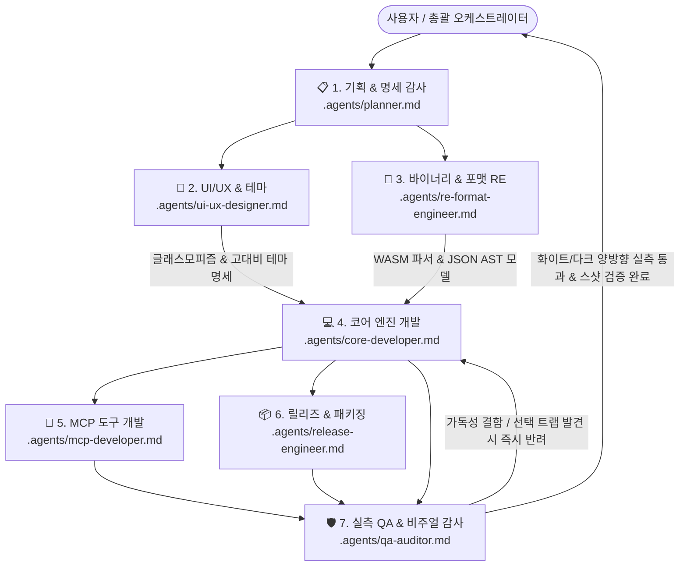

# Hanul (한울) 에이전트 협업 헌장 (Agent Collaboration Charter)

> **프로젝트 미션**:  
> [REA (Reverse Engineer Anything)](https://github.com/morluto/rea)를 활용한 한컴 바이너리/런타임 리버스 엔지니어링을 바탕으로, **과거 레거시 문서(HWP 97/3.0)부터 최신 HWPX까지 macOS · Linux · Windows 전 플랫폼에서 무료로 동작하는 독립형 HWP/HWPX 코어 엔진 및 MCP(Model Context Protocol) 서버**를 구축합니다.

---

## 👥 정예 7대 에이전트 조직 및 파이프라인 아키텍처

한울 프로젝트는 시행착오와 중복 핑퐁을 방지하기 위해 **7대 정예 에이전트 체제**로 유기적으로 협업합니다:



---

## 🔬 정예 7대 에이전트 R&R

| 번호 | 에이전트 명칭 | 정의 파일 | 주요 역할 | 기술 스택 및 산출물 |
|---|---|---|---|---|
| **1** | **기획 & 명세 감사 (Planner & Spec Auditor)** | [`.agents/planner.md`](.agents/planner.md) | 한컴 표준 스펙 분석, 기능 추적 매트릭스(`docs/SPEC_AND_TRACKING_MATRIX.md`) 실시간 동기화, QA 실측 통과 전 '완료' 판정 원천 차단 | HWP 5.0 가이드, KS X 6101 XML 명세, Spec Matrix |
| **2** | **UI/UX & 테마 디자인 (UI/UX & Theme Designer)** | [`.agents/ui-ux-designer.md`](.agents/ui-ux-designer.md) | macOS 글래스모피즘, **다크/라이트 완전 분리 테마 토큰**, 플로팅 HUD, 단축키/IME 무누수 설계, WCAG AAA 명도 대비 설계 | CSS 글래스모피즘, Design Tokens, Mac HIG |
| **3** | **바이너리 & 포맷 RE (Binary & Format RE Engineer)** | [`.agents/re-format-engineer.md`](.agents/re-format-engineer.md) | HWP 5.0 CFB/OLE 분해, `ViewText` 배포용 AES-128 복호화, Kaitai Struct 명세, Rust/WASM 파서 코드 합성 및 AST 정규화 매핑 | Ghidra, Frida, Kaitai Struct, Rust nom, ProseMirror AST |
| **4** | **코어 엔진 개발 (Core Engine Developer)** | [`.agents/core-developer.md`](.agents/core-developer.md) | Rust/WASM 코어 파서, 에디터 캔버스 렌더러, DOM 이벤트 루프, CSS 2계층 테마 분리 실구현 | Rust/WASM, TypeScript, ProseMirror, Vite |
| **5** | **MCP 도구 개발 (MCP Developer)** | [`.agents/mcp-developer.md`](.agents/mcp-developer.md) | 한컴 17대 표준 MCP 도구(누름틀, 표 조작, 메타데이터, 보안 등) 및 AI Agent 표준 Tool Contract 구현 | Model Context Protocol SDK, JSON Schema |
| **6** | **릴리즈 & 패키징 (Release & Packaging Engineer)** | [`.agents/release-engineer.md`](.agents/release-engineer.md) | macOS `Hanul.app` 번들링, 코드사인, xattr 격리 해제, 시스템 `/Applications` 설치 동기화, Windows/Linux 설치 가이드 최신화 | `build-mac-app.sh`, Apple `codesign`, `@vscode/vsce` |
| **7** | **실측 QA & 비주얼 감사 (QA & Visual Auditor)** | [`.agents/qa-auditor.md`](.agents/qa-auditor.md) | **실물 런타임 실측(Ground-Truth) 전담**, Playwright 헤드리스 스샷 자동화, 명도 대비 측정, 무손실 라운드트립 검증 | Playwright, Chromium, Jest, Pixelmatch, WCAG Formula |

---

## 🎯 가장 현실적인 역공학 및 구현 전략 (3단계 접근법)

바이너리 전체를 처음부터 무작정 디컴파일하는 것은 비효율적입니다. 다음 3단계 실용 전략을 의무적으로 적용합니다:

### 1. 공식 개방 스펙 및 실물 환경을 그라운드 트루스(Ground Truth)로 제공
- 과거 배포된 **HWP 5.0 바이너리 파일 포맷 가이드**와 개방형 표준인 **HWPX(KS X 6101 / OWPML) 표준 XML 명세서**를 기본 지식베이스로 삼습니다.
- **실물 렌더링 그라운드 트루스(Visual Ground Truth)**: 개발자 머신(macOS)에 설치된 공식 **한컴오피스 한글 Viewer**의 렌더링 화면과 `tests/fixtures/` 내 실제 공문서/공모전 HWP 파일들을 정답지(Golden Reference)로 삼아 레이아웃 왜곡, 표 테두리, 이미지 배치를 교차 검증합니다.
- **바이너리 그라운드 트루스(Binary Ground Truth)**: `tests/fixtures/` 내 실무 한글 파일들의 OLE 스트림(`DocInfo`, `BodyText`, `ViewText`, `BinData`)을 바이트 단위로 검증합니다.

### 2. HWPX 우선 분석 및 표준 AST 모델 선(先)구축
- 바이너리(CFB) 파싱보다 ZIP 압축 기반의 XML 구조인 HWPX를 먼저 파싱하여 현대적인 **문서 데이터 모델(JSON AST)**을 먼저 확립합니다. 이 AST를 기준으로 HWP 바이너리 역공학 결과를 매핑합니다.

### 3. 미공개 레코드 및 배포용 문서 타깃 역공학 (Targeted RE)
- **배포용 문서(`ViewText`) 복호화**: `BodyText`가 더미 안내문으로 잠긴 배포용 문서는 `ViewText/Section*` 내 `HWPTAG_DISTRIBUTE_DOC_DATA (0x1c)`의 시드 기반 난수 생성 및 AES-128-ECB 복호화 파이프라인을 거쳐 원본 표/서식을 100% 복원하고 편집 가능 상태로 승격(Unlock)합니다.
- 최신 한컴 버전에서 추가된 신규 태그, 확장 컨트롤, 암호화/보안 처리 로직, 미문서화된 레거시 속성에 리버스 엔지니어링 에이전트를 집중 투입합니다.

---

## ⚖️ 에이전트 공통 절대 원칙 (Prime Directives)

1. **에디터 본질 사수 헌장 (WYSIWYG Editor Integrity - 절대 뷰어로 후퇴 금지)**:
   - 한울은 단순한 텍스트 뷰어가 아닌 **"한컴 설치 없이 브라우저/VS Code에서 동작하는 완전한 위지윅(WYSIWYG) 편집기"**입니다.
   - 툴바, 폰트/글자 서식, 표 생성/수정, 타이핑 커서, 실행 취소/다시 실행, 단축키 저장이 온전히 작동해야 하며, 임의로 읽기 전용 단순 뷰어로 다운그레이드하는 행위는 엄격히 금지됩니다.
2. **무단 직접 개발 금지 (Specification First)**:
   - 기획 및 REA 실증 없이 코드를 추측하여 작성하지 않습니다.
3. **완전한 크로스 플랫폼 보장 (Zero OS Lock-in)**:
   - 윈도우 전용 API(OLE/COM, Win32 DLL, 레지스트리 등) 의존 금지. macOS, Linux, Windows 100% 동일 동작.
4. **증거 기반 역공학 및 클린룸 원칙 (Clean Room Reverse Engineering)**:
   - 한컴의 독점 소스코드를 무단 복제하지 않으며, [REA](https://github.com/morluto/rea)를 통한 관찰과 실증에 기반한 독립 재구현을 준수합니다.
5. **MCP 1급 시민 원칙 (MCP-First)**:
   - 모든 엔진 기능은 AI 에이전트가 호출할 수 있는 표준 MCP 도구로 즉시 노출되어야 합니다.
6. **무손실 보존 및 안전 장치 (Fail-Safe Round-trip)**:
   - 문서를 수정 후 저장할 때 미편집 영역의 바이트와 구조는 100% 보존되어야 합니다.
7. **실제 문서 전수 호환성 보장 (Fixtures Ground Truth)**:
   - `tests/fixtures/`에 저장된 실무 공고문, 공모전 신청서, 배포용 문서 등 모든 한글 파일이 에디터에서 왜곡 없이 열리고 저장될 수 있어야 합니다.
8. **한컴 표준 단축키 및 인터랙션 손맛 100% 사수 원칙 (Ergonomics & Shortcut Fidelity)**:
   - 한컴오피스 사용자의 수십 년 된 근육 기억(Muscle Memory)을 온전히 존중합니다.
   - `F7`(편집 용지), `Alt+L`(글자 모양), `Alt+T`(문단 모양), `F6`(스타일), `Ctrl+Alt+M`(수식), `F5`(셀 선택), `Ctrl/Alt+방향키`(표 크기 조절), `M`(합치기), `S`(나누기), `W/H`(너비/높이 같게), `Alt+Shift+E/R`(글자 크기 증감), `Alt+Insert/Delete`(줄칸 추가삭제) 등 핵심 단축키와 리본/눈금자 손맛은 임의로 생략하거나 훼손할 수 없으며, 100% 한컴과 동등하게 반응해야 합니다.
9. **글래스모피즘 및 무식한 툴바 적층 금지 (Glassmorphism & Zero Visual Waste)**:
   - 4~5단으로 무식하게 쌓여 화면을 짓누르고 가리는 조잡한 레거시 툴바 배치는 엄격히 금지됩니다.
   - macOS 네이티브 스타일의 세련된 글래스모피즘(`backdrop-filter: blur(24px) saturate(180%)`, 은은한 림 라이팅, 캡슐형 세그먼트 컨트롤)을 100% 준수합니다.
   - 표(Table) 등 특정 개체 조작 도구는 고정 적층 바가 아닌, 개체 진입/선택 시에만 나타나는 세련된 **컨텍스트 플로팅 글래스 캡슐(Floating Glass Pill/HUD)**로 일원화합니다.
10. **엄격 실측 및 무결점 QA 헌장 (Empirical Ground-Truth & Zero False-Positive Charter)**:
    - **명세서-실구현 불일치 원천 차단 (No Speculation)**: 명세서에 기능이 적혀있더라도, 실제 런타임 이벤트(마우스 클릭, 포커스, WASM 상태 변화, 레이어 합성)가 실측 통과하지 않은 기능을 임의로 '구현 완료'로 분류하는 것을 엄격히 금지합니다.
    - **QA 미검증 기능 즉시 강등 원칙**: 명세서에 존재하는 기능 중 자동화 회귀 테스트나 실측 E2E 테스트가 연결되지 않은 항목은 지체 없이 🟡(미검증/결함추적) 상태로 강등하여 투명하게 관리합니다.
    - **인터랙션 트랩 원천 방지 (Zero Selection Traps)**: 개체 배치(BehindText, 직인/서명, Z-Order, 투명 레이어 등) 시 사용자가 마우스나 한컴 표준 단축키(`F11` 개체선택, `Alt+클릭` 레이어순환)로 해당 개체를 다시 선택·이동·수정할 수 없는 '선택 불가 트랩(Selection Trap)'이 발생하지 않도록 상호작용 무결성을 100% 보장해야 합니다.
    - **스텁(Stub) 대화상자 방지**: UI 메뉴나 단축키가 연결되어 있으면서 실제 기능 대화상자가 뜨지 않거나 반응이 없는 스텁 명령은 즉시 실구현을 완료하거나 결손(Missing)으로 명확히 추적해야 합니다.
11. **다크모드/라이트모드 완전 분리 및 가독성 절대 사수 원칙 (Strict Theme Isolation & High-Contrast Readability Charter)**:
    - **테마 혼용 및 충돌 원천 금지 (Zero Theme Collisions)**: 다크 모드와 라이트 모드는 독립된 테마 계층으로 100% 분리하여 관리해야 합니다. 모달창, 툴바, 캔버스, 인풋, 드롭다운 셀렉트, 버튼 등에 단일 하드코딩된 색상(예: 다크모드에 흰색 인풋/푸터 강제 적용 등)을 주입하여 스타일이 충돌하는 행위는 엄격히 금지됩니다.
    - **가독성 결함 제로 (Zero Invisible Text - WCAG AAA 준수)**: '흰색 배경에 흰색 글씨(White-on-White)'나 '어두운 배경에 어두운 글씨(Dark-on-Dark)'로 인해 수치나 텍스트가 식별되지 않는 가독성 결함은 P0 최고 등급 결함으로 취급합니다. 모든 텍스트, 숫자 스테퍼, 라벨, 플레이스홀더, 드롭다운 옵션은 배경색과 최소 4.5:1 (본문 7:1) 이상의 명도 대비를 유지해야 합니다.
    - **양방향 테마 실측 필수 (Dual Theme Verification)**: UI/UX 변경 시 QA 에이전트는 반드시 라이트 모드(`colorScheme: 'light'`)와 다크 모드(`colorScheme: 'dark'`) 양쪽 환경 모두에서 스크린샷 캡처 및 대비 실측 테스트를 통과시켜야 하며, 한쪽 모드만 통과한 상태에서의 완료 처리는 엄격히 금지됩니다.

---

## 📁 정예 에이전트 디렉토리 구조

```
hanul-hwpx/
├── AGENTS.md                     # 에이전트 협업 헌장 (본 문서)
├── .agents/
│   ├── planner.md                # 📋 1. 기획 & 명세 감사 에이전트
│   ├── ui-ux-designer.md         # 🎨 2. UI/UX & 테마 디자인 에이전트
│   ├── re-format-engineer.md     # 🔬 3. 바이너리 & 포맷 RE 에이전트
│   ├── core-developer.md         # 💻 4. 코어 엔진 개발 에이전트
│   ├── mcp-developer.md          # 🔌 5. MCP 도구 개발 에이전트
│   ├── release-engineer.md       # 📦 6. 릴리즈 & 패키징 에이전트
│   └── qa-auditor.md             # 🛡️ 7. 실측 QA & 비주얼 감사 에이전트
└── README.md                     # 프로젝트 비전 및 공식 안내
```
