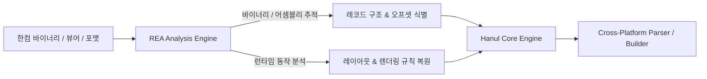
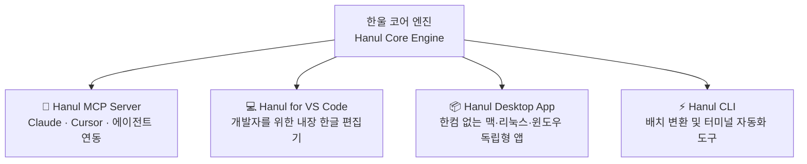

# Hanul (한울) · Universal HWP/HWPX Engine with MCP

<div align="center">

### 모든 OS에서, AI와 함께, 자유롭게 한글 문서를 다루다.
**A Free, Open-Source, Cross-Platform HWP/HWPX Engine Powered by REA & MCP**

[](LICENSE)
[](#cross-platform)
[](#legacy-support)
[](#mcp-support)
[-orange.svg)](https://github.com/morluto/rea)

<br />

[프로젝트 취지](#-프로젝트-취지--비전) · [핵심 특징](#-핵심-특징) · [레거시 호환성](#-과거-레거시-포맷-호환성-hwp-97--30--5x) · [REA 기반 리버스 엔지니어링](#-rea-기반-리버스-엔지니어링-전략) · [MCP 아키텍처](#-mcp-model-context-protocol-지원) · [로드맵](#-로드맵)

</div>

---

## 💡 프로젝트 취지 & 비전

대한민국의 공공기관, 교육기관, 연구소 및 수많은 기업에서 여전히 **HWP / HWPX(한글 문서)**는 필수적인 표준 문서 포맷으로 사용되고 있습니다. 그러나 현실은 다음과 같은 깊은 장벽에 가로막혀 있습니다:

1. **플랫폼 종속성**: 한컴오피스는 오랫동안 윈도우(Windows) 독점 환경을 중심으로 발전해 왔으며, macOS나 Linux 사용자는 제한적인 뷰어 기능에 의존하거나 별도의 가상 머신/Wine을 사용해야만 했습니다.
2. **AI 시대의 단절**: 전 세계는 LLM(대형 언어 모델)과 AI 에이전트(Claude Code, Cursor, Antigravity 등)를 통한 문서 자동화와 RAG(검색 증강 생성)의 시대로 나아가고 있지만, 한글 문서는 폐쇄적인 바이너리 구조와 비표준 처리 방식으로 인해 AI 에이전트가 직접 읽고 쓰기 가장 어려운 포맷으로 남아 있습니다.
3. **독점적 라이브러리 및 고비용 라이선스**: 한글 문서를 자동화하거나 웹/서버에서 다루기 위해서는 높은 비용의 상용 솔루션이나 윈도우 서버 환경이 강제되었습니다.
4. **수십 년간 잠든 방대한 레거시 문서**: 공공 아카이브, 과거 학술 논문, 법률 문서 중 상당수가 구형 한컴 포맷(HWP 97, HWP 3.0, 초기 HWP 5.x)으로 보관되어 있어 최신 환경에서 열람 및 텍스트 추출이 불가능하거나 서식이 깨지는 디지털 소외 문제가 발생하고 있습니다.

**한울(Hanul)**은 이 모든 문제를 해결하기 위해 출발했습니다.
우리는 [REA (Reverse Engineer Anything)](https://github.com/morluto/rea)를 활용하여 한컴 바이너리 및 런타임을 심층 리버스 엔지니어링하고, **과거 레거시 문서부터 최신 HWPX까지, macOS, Linux, Windows 모든 OS에서 네이티브로 구동되는 완전 무료 오픈소스 한글 문서 엔진**을 구축합니다. 나아가 **MCP(Model Context Protocol)**를 기본 탑재하여 AI 에이전트가 한글 문서를 자유자재로 제어하는 차세대 생태계를 엽니다.

---

## 🌟 핵심 특징

### 1. 🌐 True Cross-Platform (macOS · Linux · Windows)
- 윈도우 전용 OLE/COM 객체나 네이티브 DLL에 의존하지 않는 순수한 크로스 플랫폼 엔진.
- macOS(Apple Silicon/Intel), Linux(x64/ARM64), Windows 어디서나 CLI, 라이브러리, GUI 형태로 동일하게 동작.

### 2. 📜 과거 레거시 포맷(HWP 97 / 3.0 / HWP 5.x 초기형) 하위 호환 및 보존
- 1990년대 DOS/초기 Windows 시절의 HWP 3.0, HWP 97부터 현대의 HWP 5.x 바이너리 및 최신 KS X 6101 HWPX까지 아우르는 폭넓은 포맷 지원.
- 옛 한글 조합형/완성형 2바이트 문자셋(KSSM, EUC-KR)과 레거시 비트맵 폰트/표 구조를 안전하게 디코딩하여 현대의 UTF-8 및 HWPX/Markdown으로 무손실 복원(Digital Preservation).

### 3. 🔍 REA 기반의 정밀 리버스 엔지니어링
- [morluto/rea](https://github.com/morluto/rea)의 바이너리·어셈블리·런타임 분석 프레임워크를 기반으로 공식 스펙 문서만으로는 알 수 없는 한컴의 실제 렌더링 규칙, 미공개 레코드, 수식 스크립트, 표 레이아웃 계산 로직을 실증(Evidence) 기반으로 완벽 해독.
- HWP 5.x 바이너리 포맷(Compound File / Deflate 압축)부터 HWPX(KS X 6101 OWPML 표준)까지 무손실 파싱 및 생성 지원.

### 4. 🤖 AI 에이전트를 위한 MCP (Model Context Protocol) 탑재
- Claude Desktop, Claude Code, Cursor, Antigravity 등 최신 AI 도구와 즉시 연동되는 MCP 서버 내장.
- 자연어로 "30년 전 HWP 97 공문서를 읽어서 최신 요약 마크다운으로 변환해줘", "보고서의 3번째 표에 분기별 매출 데이터를 채워 넣어줘"와 같은 에이전틱 문서 작업 지원.

### 5. 🎁 100% 무료 & 오픈소스 (Free & Open Source)
- 개인, 학생, 연구자, 공공, 스타트업 모두가 비용 부담 없이 자유롭게 활용할 수 있는 MIT 라이선스 기반의 완전 무료 배포.

---

## 🔬 REA 기반 리버스 엔지니어링 전략

한컴 문서 형식(특히 HWP 5.x)은 복잡한 Compound 파일 구조와 비트 플래그, 미문서화된 레코드 태그를 포함하고 있어 단순한 문서 명세만으로는 온전한 호환성을 확보하기 어렵습니다.

한울 프로젝트는 **REA (Reverse Engineer Anything)**를 리버스 엔지니어링의 핵심 엔진으로 활용합니다:



- **바이너리 레코드 구조 완벽 분석**: `HWPTAG_DOCUMENT_PROPERTIES`, `HWPTAG_CHAR_SHAPE`, `HWPTAG_PARA_HEADER` 등 HWP 5.0 레코드 구조의 정확한 바이트 패킹 및 버전별 호환 필드 분석.
- **수식 및 특수 개체 복원**: 한글 고유의 수식 스크립트 문법 및 컨트롤 개체(그리기 개체, OLE 컨테이너, 필드) 직렬화 메커니즘 역공학.
- **실증 기반 호환성 검증(Evidence-based Validation)**: 추출한 로직과 실제 한컴오피스 렌더링 결과 간의 픽셀/데이터 일치율을 지속적으로 검증.

---

## 🔌 MCP (Model Context Protocol) 지원

한울은 현대 AI 에이전트 표준 프로토콜인 **MCP**를 1급 시민(First-class Citizen)으로 지원합니다.

```mermaid
flowchart TD
    Agent[AI 에이전트\nClaude / Cursor / Antigravity] <-->|MCP Protocol (JSON-RPC)| Server[Hanul MCP Server]
    Server <--> Core[Hanul Core Engine\nmacOS / Linux / Windows]
    Core <--> File[(.hwp / .hwpx)]
```

### 제공 예정 MCP 도구 (Tool Catalog Preview)

| MCP Tool | 설명 |
|---|---|
| `hanul_read_document` | HWP/HWPX 문서의 본문, 메타데이터, 개요 구조를 마크다운/텍스트로 추출 |
| `hanul_inspect_tables` | 문서 내 모든 표의 구조, 셀 좌표, 텍스트 및 서식을 구조화된 JSON으로 반환 |
| `hanul_edit_table_cells` | 지정한 표와 셀 좌표에 데이터를 삽입/수정하고 서식을 갱신 |
| `hanul_create_hwpx` | 마크다운/JSON 명세를 바탕으로 규격에 맞는 새 HWPX 문서 생성 |
| `hanul_convert_format` | HWP ↔ HWPX ↔ Markdown ↔ PDF 무손실/고품질 상호 변환 |
| `hanul_find_and_replace` | 문서 내 서식을 유지한 채 텍스트 검색 및 일괄 치환 |

---

## 🖥️ 사용자 제공 제품군 (Product Ecosystem)

한울은 단일 라이브러리에 그치지 않고, 개발자부터 일반 사용자, AI 에이전트까지 아우르는 3대 프론트엔드를 제공합니다:



1. **💻 VS Code 확장 (Hanul for VS Code)**
   - 개발 환경에서 창 전환 없이 `.hwp`, `.hwpx` 파일을 VS Code Custom Editor로 즉시 열람 및 인라인 편집.
   - 깃(Git) 버전 관리와 연계한 문서 차이 확인 및 마크다운과의 상호 변환.
2. **📦 독립형 데스크톱 앱 (Hanul Desktop App - macOS · Linux · Windows)**
   - VS Code가 설치되어 있지 않은 일반 사용자, 공공/학술 인력을 위한 경량 스탠드얼론(Standalone) 애플리케이션.
   - 무거운 상용 오피스 설치나 계정 로그인 없이, 1초 만에 실행되는 쾌적한 한글 뷰어 & 위지윅(WYSIWYG) 편집기.
3. **🤖 Hanul MCP Server**
   - Claude Desktop, Cursor 등 AI 에이전트가 한글 문서를 직접 읽고 조작할 수 있는 표준 프로토콜 서버.
4. **⚡ Hanul CLI**
   - CI/CD 파이프라인이나 서버 환경에서 HWP ↔ HWPX ↔ Markdown 변환을 지원하는 독립 실행형 도구.

---

## 🏗️ 시스템 아키텍처

한울은 모듈화된 계층형 모노레포(Monorepo) 아키텍처로 구성됩니다:

```
hanul-hwpx/
├── engine/               # [Core] 순수 크로스 플랫폼 한글 파서/빌더 (TypeScript/Rust/Wasm)
│   ├── hwp/              # 2000년대~ HWP 5.x Compound Document & Record 파서
│   ├── hwpx/             # KS X 6101 XML/OPC 파서 및 직렬화기
│   └── layout/           # 텍스트, 문단, 표 레이아웃 계산기
├── mcp/                  # [MCP] Model Context Protocol 서버 구현체 (AI 연동)
│   └── tools/            # 문서 탐색, 표 수정, 문서 생성용 MCP 도구 모음
├── apps/                 # [Applications] 사용자 인터페이스
│   ├── vscode-extension/ # [VS Code] VS Code 전용 내장 웹뷰 에디터 확장
│   └── desktop/          # [Desktop App] OS별 독립 설치형 데스크톱 앱 (macOS/Linux/Win)
├── cli/                  # [CLI] 모든 OS 터미널에서 작동하는 커맨드라인 도구
└── research/             # [REA] REA 기반 리버스 엔지니어링 분석 스크립트 및 증거 모음
```

---

## 🗺️ 로드맵

- [x] **Phase 0: 프로토타입 검증 (v0.1.0)**
  - rhwp 기반 VS Code 확장 및 웹뷰 렌더러 시제품 구현
  - 기초적인 HWPX 파일 저장/열기 및 백업 메커니즘 동작 확인
- [ ] **Phase 1: REA 기반 한컴 리버스 엔지니어링 & 스펙 표준화**
  - [rea](https://github.com/morluto/rea)를 활용한 2000년대~ HWP 5.x 레코드 및 HWPX 미공개 규격 정밀 분석
  - 암호화, 압축, 복합 스트림 파싱 파이프라인 정리 및 Rust/TypeScript 기반 코어 엔진 착수
- [ ] **Phase 2: Hanul MCP Server 구현**
  - HWP/HWPX 읽기, 표 파싱, 텍스트 검색/수정 MCP 도구 개발
  - Claude Desktop, Cursor 등과의 로컬 연동 및 AI 문서 편집 테스트
- [ ] **Phase 3: VS Code 확장 고도화 & 독립형 데스크톱 앱(Desktop App) 출시**
  - **Hanul for VS Code**: 성능 개선 및 독립 엔진 교체
  - **Hanul Desktop App**: 맥(`.dmg`), 리눅스(`.AppImage`), 윈도우(`.exe`) 독립형 설치 파일 배포
- [ ] **Phase 4: 완전한 크로스 플랫폼 CLI 및 공공 에코시스템 확장**
  - 대용량 문서 배치 변환 CLI 완성
  - 공공문서 템플릿 자동화 기능 및 오픈소스 커뮤니티 기여 체계 확립

---

## 🤝 프로젝트 참여 & 기여

한울은 **한글 문서의 자유로운 사용과 플랫폼 독립**을 꿈꾸는 모든 분들의 기여를 환영합니다!
- 리버스 엔지니어링 및 바이너리 분석에 관심 있는 분
- Rust / TypeScript / C++ / WebAssembly 크로스 플랫폼 엔진 개발자
- MCP 및 AI 에이전트 워크플로우를 설계하고 테스트할 분
- 다양한 HWP/HWPX 샘플 문서 검증 및 버그 제보

이슈 제안이나 기능 요청은 언제든지 [GitHub Issues](https://github.com/iamywl/hanul-hwpx/issues)를 통해 남겨주세요.

---

## ⚖️ 라이선스 및 법적 고지

- **코드 라이선스**: 본 프로젝트의 소스 코드는 **MIT License**에 따라 자유롭게 사용, 수정, 배포할 수 있습니다.
- **연구 및 호환성 고지**: 본 프로젝트는 대한민국 저작권법 및 관련 국제 규약에 따른 정당한 상호호환성 확보, 학술 연구, 소프트웨어 보존을 목적으로 합법적인 클린룸 리버스 엔지니어링 기법을 적용합니다.
- **독립성 고지**: 본 프로젝트는 (주)한글과컴퓨터와 제휴, 후원, 또는 보증 관계가 없는 순수 독립 오픈소스 프로젝트입니다.
- **참조 프로젝트**: 바이너리 및 런타임 분석을 위해 [morluto/rea](https://github.com/morluto/rea) 프로젝트를 적극 활용하고 협력합니다.
