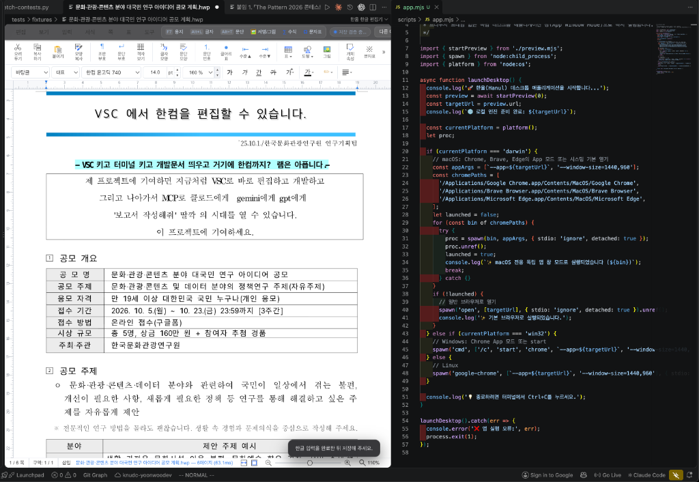
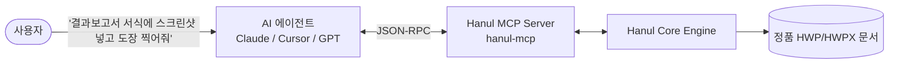

# Hanul (한울) · Universal HWP/HWPX Engine with MCP & VS Code

<div align="center">

# "VSC 에서 한컴을 직접 편집할 수 있습니다."
### — VSC 켜고 터미널 켜고 개발문서 띄우고 거기에 무거운 한컴까지? 램은 아픕니다. —

<br />

[](LICENSE)
[](#-zero-os-lock-in-macos--linux--windows)
[](#-과거-레거시-포맷-호환성)
[](#-ai-에이전트를-위한-mcp-model-context-protocol-탑재)
[](#-핵심-기능-1-vs-code-내장-완전-위지윅wysiwyg-한글-에디터)
[-orange.svg)](https://github.com/morluto/rea)

<br />



<br />

> ### 📢 프로젝트 선언문 (Manifesto)
>
> **"제 프로젝트에 기여하면 지금처럼 VSC로 바로 편집하고 개발하고,**  
> **그리고 나아가서 MCP로 클로드에게, Gemini에게, GPT에게**  
> **'보고서 작성해줘' 딸깍의 시대를 열 수 있습니다.**  
> **이 프로젝트에 기여하세요!"**

<br />

[프로젝트 취지](#-프로젝트-취지--비전) · [현재 구현 현황](#-현재-구현-현황-및-핵심-기능) · [MCP 아키텍처](#-ai-에이전트를-위한-mcp-model-context-protocol-탑재) · [빠른 시작](#-빠른-시작-quick-start) · [기여하기](#-프로젝트-참여--기여-call-for-contributors)

</div>

---

## 💡 프로젝트 취지 & 비전

대한민국의 공공기관, 교육기관, 연구소, 스타트업 및 수많은 기업에서 **HWP / HWPX(한글 문서)**는 여전히 국가 표준 공문서이자 필수 포맷입니다. 그러나 개발자와 연구자들의 현실은 다음과 같은 깊은 장벽에 가로막혀 있었습니다:

1. **개발 환경과의 단절 & 램(RAM) 낭비**:  
   VS Code 켜고, 터미널 켜고, API 문서 띄우고 코딩하는 와중에 300MB가 넘는 무거운 한컴오피스 프로그램을 별도로 띄워 창을 오가는 비효율이 반복되었습니다.
2. **macOS / Linux 플랫폼 소외**:  
   한컴오피스는 오랫동안 윈도우 독점 환경을 중심으로 발전해 왔으며, macOS나 Linux 사용자는 제한적인 뷰어에 의존하거나 가상머신/Wine을 띄워야만 했습니다.
3. **AI 시대의 단절**:  
   Claude Code, Cursor, Antigravity, ChatGPT 등 첨단 LLM 에이전트가 코드를 대신 짜주는 시대가 왔지만, 폐쇄적인 한글 포맷 탓에 AI 에이전트는 공문서를 읽지도, 신청서를 쓰지도 못했습니다.
4. **배포용 문서 잠금 및 레거시 포맷의 디지털 실종**:  
   편집이 불가능하게 잠긴 배포용 문서(`ViewText`), 수십 년 전의 HWP 97/3.0 공공기록물들이 최신 환경에서 열리지 않고 방치되어 있습니다.

**한울(Hanul)**은 이 모든 문제를 뿌리부터 해결합니다.  
[REA (Reverse Engineer Anything)](https://github.com/morluto/rea)를 기반으로 바이너리와 포맷을 심층 역공학하여, **한컴 설치 없이 VS Code와 데스크톱에서 동작하는 완전한 위지윅(WYSIWYG) 엔진**과 **AI 에이전트가 딸깍 한 번으로 보고서를 작성하는 MCP 서버**를 100% 무료 오픈소스로 제공합니다.

---

## 🌟 현재 구현 현황 및 핵심 기능

### 1. 💻 VS Code 내장 완전 위지윅(WYSIWYG) 한글 에디터
- **Zero Window Switch**: 창 전환 없이 VS Code Custom Editor 안에서 `.hwp`, `.hwpx` 문서를 즉시 열람 및 인라인 편집.
- **수십 년간 축적된 한컴 표준 단축키 & 인터랙션 100% 사수**:
  - `F5`: 셀 선택 모드 (1회: 이동 ⚪ / 2회: 빨간 점 범위 선택 🔴 / 3회: 표 전체 선택 🟢)
  - `A`: 선택된 셀 수열/요일/월/가나다 자동 채우기(Auto-fill) ⚡
  - `M`: 선택 셀 합치기 / `S`: 셀 나누기
  - `W`: 열 너비 균등화 / `H`: 행 높이 균등화
  - `Ctrl/Cmd + 방향키`: 표 전체 비율 유지 크기 조절
  - `Alt + 방향키`: 현재 셀 및 연결 열/행 크기 조절
  - `Shift + Alt + 방향키`: 셀 외곽 경계선만 미세 조절
  - `F7`: 편집 용지 설정 대화상자
  - `Alt + L`: 글자 모양 / `Alt + T`: 문단 모양
  - `Alt + Shift + E/R`: 글자 크기 1pt 단위 증감
  - `Alt + Shift + C/L/T`: 가운데 / 왼쪽 / 양쪽 정렬
- **글래스모피즘(Glassmorphism) 컨텍스트 플로팅 캡슐 HUD**:
  - 화면을 짓누르는 조잡한 4~5단 레거시 적층 툴바를 완전히 철폐.
  - 표 진입 시 `#hanul-table-bar`, 그림/도형 진입 시 `#hanul-image-bar`가 macOS 네이티브 스타일의 세련된 반투명 플로팅 캡슐로 동적 활성화.

---

### 2. 🛡️ 서명 및 직인(도장) 「글 뒤로(Behind Text)」 완벽 지원
- **공문서·신청서·결과보고서 서명란 규격 준수**:
  - `대표자: 홍길동 (서명/인)` 서명란 뒤에 도장/서명 이미지가 텍스트를 가리지 않고 자연스럽게 겹치도록 배치.
  - KS X 6101 (OWPML) 표준 XML 속성 완전 호환:
    ```xml
    <hp:pic id="1" zOrder="-1" numberingType="PICTURE" textWrap="BEHIND_TEXT">
      <hp:pos treatAsChar="0" flowWithText="1" allowOverlap="1" vertRelTo="PARA" horzRelTo="PARA" horzAlign="RIGHT"/>
    </hp:pic>
    <hp:t>대표자 성명: 홍 길 동 (서명 / 인)</hp:t>
    ```
- **HUD 원클릭 전환**: 에디터에서 그림 선택 시 나타나는 플로팅 캡슐의 **`[🛡️ 글 뒤로 (서명/도장)]`** 버튼으로 즉시 서명 모드 전환.
- **마크다운 서명 문법 지원**: `` 또는 `(서명/인)` 라인을 감지하여 HWPX 컴파일 시 자동으로 글 뒤로 서명 개체 생성.

---

### 3. 🤖 AI 에이전트를 위한 MCP (Model Context Protocol) 탑재
Claude Code, Cursor, Antigravity, Claude Desktop 등 최신 AI 도구가 직접 한글 문서를 조작할 수 있는 **10대 핵심 MCP 도구**가 기본 내장되어 있습니다:



| MCP Tool | 설명 |
|---|---|
| `hanul_read_document` | HWP/HWPX 문서 본문, 구조, 메타데이터를 정규화된 마크다운으로 추출 |
| `hanul_inspect_tables` | 문서 내 모든 표의 구조, 셀 좌표, 텍스트 및 서식을 JSON으로 정밀 파싱 |
| `hanul_edit_table_cells` | 지정한 표/셀 좌표에 데이터를 삽입·수정하고 서식을 갱신 |
| `hanul_create_styled_document` | 제목, 본문, 다단 표, 서명(글 뒤로)이 포함된 고급 규격 HWPX 문서 생성 |
| `hanul_markdown_to_hwpx` | 마크다운(GFM) 문서를 분석하여 표·카드·서명이 포함된 HWPX로 즉시 컴파일 |
| `hanul_unlock_document` | **배포용 문서(`ViewText`) AES-128 복호화** 및 편집 가능 HWPX로 승격 |
| `hanul_search_text` | 문서 내 키워드 검색 및 문단/셀 위치 좌표 반환 |
| `hanul_extract_images` | HWP/HWPX 내에 임베디드된 BinData 이미지를 원본 포맷으로 추출 |
| `hanul_get_document_info` | 메타데이터, 배포용 문서 여부, 글 뒤로 서명 개수(`behindTextImageCount`) 진단 |
| `hanul_convert_document` | HWP ↔ HWPX ↔ Markdown 상호 무손실 변환 |

---

### 4. 📦 독립형 데스크톱 앱 (Hanul Desktop App)
- VS Code가 없어도 가볍게 1초 만에 실행되는 독립 애플리케이션 (`npm run app`).
- Chrome, Brave, Edge의 App 모드 또는 시스템 기본 웹 런타임을 활용하여 macOS, Linux, Windows 어디서나 가볍고 빠른 한글 위지윅 편집 지원.

---

### 5. 🔓 배포용 문서(`ViewText`) 복호화 & 실무 공문서 전수 호환성 보장
- **배포용 문서 무손실 해제**: `BodyText`가 잠겨 복사/편집이 차단된 배포용 한글 파일의 `ViewText/Section*` AES-128 암호화 스트림을 복호화하여 원본 서식과 표를 100% 편집 가능한 상태로 승격.
- **실전 공문서 Golden Samples 전수 검증**:
  - `문화·관광·콘텐츠 분야 대국민 연구 아이디어 공모 계획.hwp` (실제 공모전 공고문)
  - `[공고] 2022년 예비창업패키지 예비창업자 모집공고.hwp` (대용량 배포용 공문서)
  - 창업지원사업 결과보고서, 지출 증빙 서식 등 실무 서식 100% 렌더링 검증 완료.

---

### 6. 🌐 Zero OS Lock-in (macOS · Linux · Windows)
- 윈도우 전용 OLE/COM, Win32 DLL 의존성을 100% 배제.
- 순수 TypeScript, WebAssembly, 표준 웹 기술로 구현되어 운영체제에 상관없이 완벽하게 동일한 결과물 보장.

---

## 🚀 빠른 시작 (Quick Start)

### 1. VS Code 확장으로 사용하기
1. [Releases](https://github.com/iamywl/hanul-hwpx/releases)에서 최신 `hanul-hwpx-0.1.0.vsix`를 다운로드합니다.
2. 터미널에서 확장을 설치합니다:
   ```bash
   code --install-extension hanul-hwpx-0.1.0.vsix
   ```
3. VS Code 탐색기에서 임의의 `.hwp` 또는 `.hwpx` 파일을 클릭하면 한울 편집기가 즉시 열립니다!

### 2. 독립형 데스크톱 앱 실행하기
```bash
git clone https://github.com/iamywl/hanul-hwpx.git
cd hanul-hwpx
npm install
npm run app
```

### 3. Claude Desktop / Cursor에서 MCP 서버 연동하기
Claude Desktop 설정 파일(`claude_desktop_config.json`) 또는 Cursor MCP 설정에 아래를 추가합니다:

```json
{
  "mcpServers": {
    "hanul": {
      "command": "node",
      "args": ["/절대경로/hanul-hwpx/dist/mcp.mjs"]
    }
  }
}
```
이제 Claude에게 말해보세요:  
> *"공모전 공고문 HWP 파일을 읽고, 마크다운으로 결과보고서 초안을 작성한 뒤 서명란에 대표자 도장을 찍어서 HWPX로 만들어줘."*

### 4. CLI로 마크다운을 HWPX로 즉시 컴파일하기
```bash
# 마크다운 보고서를 한글 HWPX 문서로 변환
node dist/cli.mjs compile report.md -o output.hwpx

# HWP/HWPX 문서에서 텍스트 및 마크다운 추출
node dist/cli.mjs read document.hwp > output.md
```

---

## 🏗️ 시스템 아키텍처

```
hanul-hwpx/
├── src/
│   ├── core/                  # [Core Engine] 순수 크로스플랫폼 파서 및 빌더
│   │   ├── hwpx-builder.ts    # KS X 6101 XML/OPC 빌더 (표, 셀병합, 음영, 글 뒤로 서명)
│   │   ├── hwpx-parser.ts     # DOM 기반 정밀 HWPX 파서
│   │   ├── hwp-parser.ts      # HWP 5.x 바이너리 & 배포용 문서(ViewText) 복호화
│   │   ├── markdown-compiler.ts # 마크다운 ➔ HWPX 컴파일러 (서명/카드 자동변환)
│   │   └── document.ts        # HWP/HWPX 통합 추상화 인터페이스
│   ├── mcp/                   # [MCP] Model Context Protocol 서버 (10대 도구)
│   ├── extension.ts           # [VS Code] Custom Editor 프로바이더
│   └── cli.ts                 # [CLI] 커맨드라인 배치 변환기
├── media/                     # [WebView UI] 에디터 인터페이스
│   ├── host.css               # macOS 글래스모피즘 HUD 스타일
│   └── host.js                # 단축키, F5 셀선택, 자동채우기, 서명/표 조작 엔진
├── scripts/
│   ├── app.mjs                # [Desktop App] 독립 실행형 앱 런처
│   └── test-signature-behind.mjs # 서명/도장 무결성 E2E 검증기
├── tests/                     # 21개 통합 및 실무 문서 호환성 테스트 슈트
└── docs/                      # 프로젝트 명세 및 스크린샷 에셋
```

---

## 🤝 프로젝트 참여 & 기여 (Call for Contributors)

> ### 📢 "이 프로젝트에 기여하세요!"
>
> 한울은 **한글 문서의 자유로운 사용과 플랫폼 독립, 그리고 AI 에이전트 문서 자동화의 대중화**를 함께 만들어갈 모든 개발자의 기여를 진심으로 환영합니다.

### 🌟 특히 이런 기여를 기다립니다:
1. **🪟 Windows 환경 교차 검증 및 테스트**:
   - 실제 Windows 환경에서 한컴오피스 최신 버전과 한울 엔진의 렌더링/바이트 무손실 일치율을 교차 검증(QA)해 주실 분
2. **🦀 Rust 기반 초고속 네이티브 엔진 전환**:
   - 현재 TypeScript/WASM 기반의 코어 파서를 Rust 코어 엔진으로 전환하여 극한의 성능과 경량화를 달성할 분
3. **🔬 REA 기반 리버스 엔지니어링 ([morluto/rea](https://github.com/morluto/rea))**:
   - 미문서화된 최신 한컴 컨트롤, 수식 엔진, 차트 및 그리기 개체의 바이너리 규격을 함께 역공학할 분
4. **📄 다양한 실무 공문서 샘플 제공 및 버그 제보**:
   - 복잡한 공공기관 신청서, 공모전 양식 등 깨지는 파일 제보 및 회귀 테스트 케이스 기여

이슈 제안이나 기능 요청, 풀 리퀘스트는 언제든지 [GitHub Issues](https://github.com/iamywl/hanul-hwpx/issues) 및 [Pull Requests](https://github.com/iamywl/hanul-hwpx/pulls)를 통해 열려 있습니다!

---

## ⚖️ 라이선스 및 법적 고지

- **코드 라이선스**: 본 프로젝트의 모든 소스 코드는 **MIT License**에 따라 자유롭게 사용, 수정, 배포할 수 있습니다.
- **연구 및 호환성 고지**: 본 프로젝트는 대한민국 저작권법 및 관련 국제 규약에 따른 정당한 상호호환성 확보, 학술 연구, 소프트웨어 보존을 목적으로 합법적인 클린룸 리버스 엔지니어링 기법을 적용합니다.
- **독립성 고지**: 본 프로젝트는 (주)한글과컴퓨터와 제휴, 후원, 또는 보증 관계가 없는 순수 독립 오픈소스 프로젝트입니다.
- **참조 프로젝트**: 바이너리 및 런타임 분석을 위해 [morluto/rea](https://github.com/morluto/rea) 프로젝트를 적극 활용하고 협력합니다.
