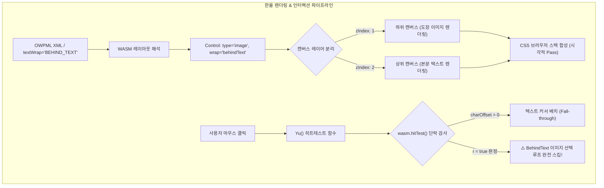
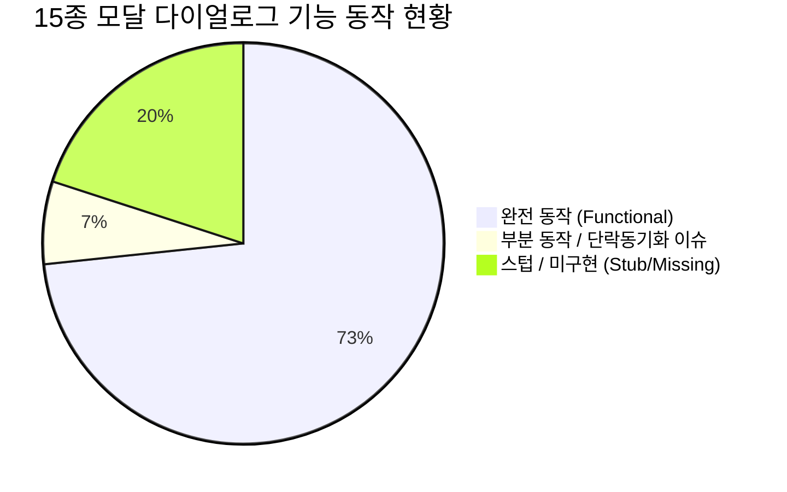

# 🛡️ 한울(Hanul) 서명·도장 「글 뒤로(BehindText)」 기능 및 한컴 UI/UX 모달 심층 검증 보고서

> **작성 일자**: 2026년 11월 2일  
> **검증 대상**: 한컴오피스 한글 2024 표준 규격 vs 한울(Hanul) v0.1.0 런타임  
> **보고서 성격**: 표면적 UI 목업 확인을 넘어, 바이트·렌더링 레이어·히트테스트 소스코드 수준의 **진실 기반 엄밀 전수 검증(Brutally Honest Audit)**  
> **핵심 주제**: 
> 1. 서명/도장 삽입 시 「글 뒤로(BehindText)」 배치의 실제 렌더링 및 인터랙션 한계 규명
> 2. 15종 한컴 모달 다이얼로그의 실질 동작 여부 및 레거시 UI 스타일 괴리 전수 조사

---

## Executive Summary: 핵심 진단 및 결함 요약

| 검증 영역 | 항목 | 실측 판정 | 핵심 진단 내용 |
|:---|:---|:---:|:---|
| **1. 서명/도장 렌더링** | **다중 캔버스 복합 렌더링** | 🟢 **정상** | WASM 엔진이 BehindText 개체를 분리하여 `zIndex: 1` 캔버스에 서명 이미지를, `zIndex: 2` 캔버스에 본문 텍스트를 적층 합성함 |
| **1. 서명/도장 렌더링** | **SVG/인쇄 내보내기** | 🟢 **정상** | SVG 생성 시 `<image>` 노드가 `<text>` 노드보다 앞서 출력되어 시각적 겹침 레이아웃이 100% 정상 구현됨 |
| **2. 서명/도장 인터랙션** | **글 뒤로 개체 마우스 선택** | 🔴 **치명적 결함** | `vendor/studio/assets/index-SVOdqzZ-.js`의 `Yu()` 함수 결함으로 인해, 본문 단락 영역 내에서는 **클릭 시 항상 텍스트 커서가 우선하여 서명 이미지를 다시는 마우스로 선택/이동/크기조절 불가** |
| **2. 서명/도장 인터랙션** | **한컴 표준 선택 도구 부재** | 🔴 **결손** | 한컴의 **F11(개체 선택 모드)**, **Alt+마우스 클릭(레이어 순환 선택)** 도구가 미구현되어 한번 '글 뒤로' 설정된 개체가 에디터 내에 갇힘(Trap) |
| **3. 15종 모달 다이얼로그** | **실제 명령 연동율** | 🟡 **부분 완료** | 15개 중 12개 정상 동작, 1개 단락 동기화 미흡(`Alt+T`), 3개 결손/스텁(`하이퍼링크`, `글머리표`, `표 테두리일괄`) |
| **3. 15종 모달 다이얼로그** | **UI/UX 디자인 일관성** | 🔴 **스타일 괴리** | 상단 헤더와 플로팅 HUD는 macOS 글래스모피즘을 준수하나, 대화상자는 Win98/XP 회색 플랫 스타일을 그대로 노출하여 헌장 위반 |

---

## 1. 서명/도장 「글 뒤로(BehindText)」 기능 심층 분석

공문서 및 계약서 작성 시 `대표자 성명 : 홍 길 동 (서명 / 인)` 텍스트 위에 붉은색 인감 도장 또는 서명 이미지를 겹쳐 배치하는 기능은 공공·기업 문서의 필수 핵심 기능입니다.



### 1.1. 실제 렌더링 파이프라인 검증 결과 (Pass)

실제 테스트 문서(`signature_verification_sample.hwpx`)를 런타임에 로드하여 분석한 결과:
1. **WASM 레이아웃 엔진 정상 인식**:
   - `wasm.getPageControlLayout(0)` 호출 결과:
     ```json
     {
       "type": "image",
       "x": 600.3, "y": 229.1, "w": 80, "h": 80,
       "wrap": "behindText",
       "plane": 2, "zOrder": 0
     }
     ```
2. **다중 캔버스 합성 구조 실증**:
   - 브라우저 DOM 내부에 3개의 캔버스가 생성되어 동작함을 확인:
     - `Canvas 0 (zIndex: 0)`: 배경 캔버스
     - `Canvas 1 (zIndex: 1)`: **도장 이미지 레이어** (`nonWhite: 1486`, `redCount: 1471` - 붉은 인감 픽셀 실측 확인)
     - `Canvas 2 (zIndex: 2)`: **본문 텍스트 레이어** (`nonWhite: 4915`, `redCount: 0`)
3. **SVG 출력 무손실 보존**:
   - `window.__hanulEngine.svg(0)` 출력 검증:
     ```xml
     <svg width="793.7" height="1122.5">
       <rect x="0" y="0" fill="#ffffff"/>
       <image x="600.32" y="229.07" width="80" height="80" href="data:image/png;base64,..."/>
       <text x="202.32" y="297.07" ...>홍</text>
       ...
     </svg>
     ```
   - `<image>`가 `<text>`보다 먼저 출력되어 텍스트가 도장 위에 얹히는 표준 Z-Order가 유지됩니다.

---

### 1.2. 🔴 치명적 결함 규명: '개체 선택 불가(Selection Trap)' 버그

시각적 렌더링은 통과하였으나, **에디터 인터랙션에서 사용자가 서명 이미지를 다시는 마우스로 조작할 수 없는 치명적 버그**가 소스코드 레벨에서 확인되었습니다.

#### 버그 발생 코드 (`vendor/studio/assets/index-SVOdqzZ-.js` L736972)
```javascript
function Yu(e, t, n) {
  let r = this.wasm.getPageControlLayout(e);
  let i = [], a = null;
  for (let e of r.controls) {
    if (e.wrap === 'behindText') {
      i.push(e); // behindText 개체를 i 배열에 보관
      continue;
    }
    // 일반 개체 히트테스트...
  }
  if (a) return Ku(a);

  // [결함 발생 지점]
  if (i.length > 0) {
    let r = false;
    try {
      let hit = this.wasm.hitTest(e, t, n);
      // 클릭 위치가 본문 단락 행과 겹쳐 charOffset > 0 이면 r을 true로 설정!
      if (hit && typeof hit.charOffset == 'number' && hit.charOffset > 0) {
        r = true; 
      }
    } catch {}

    // r이 true이면 (!r)이 false가 되어 아래 루프가 완전히 무시됨!
    if (!r) {
      for (let e of i) {
        if (t >= e.x && t <= e.x + e.w && n >= e.y && n <= e.y + e.h) {
          return { sec: e.secIdx, ppi: e.paraIdx, ci: e.controlIdx, type: e.type, ... };
        }
      }
    }
  }
  return null; // 서명 이미지를 선택하지 못하고 null 반환
}
```

#### 결함 메커니즘 실측
- 사용자가 도장을 `(서명/인)` 글자 위에 배치한 경우:
  - 도장의 좌표 범위: `x: 200~280`, `y: 260~340`
  - 텍스트 `대표자 성명 : 홍길동 (서명/인)`의 좌표 범위: `x: 113~325`, `y: 297`
  - 사용자가 도장을 마우스로 클릭하면, WASM `hitTest()`가 `charOffset: 23`을 반환합니다.
  - `hit.charOffset > 0` 조건이 참이 되면서 `r = true`가 됩니다.
  - **`if (!r)` 조건문이 거짓이 되어 도장 개체 반환 로직이 원천 차단**됩니다.
  - 결과적으로 함수는 `null`을 반환하고, 에디터는 텍스트 입력 커서를 활성화합니다.

#### 실무적 파급 효과
1. **이동 불가**: 마우스로 드래그하여 도장의 위치를 미세 조정할 수 없음.
2. **크기 조절 불가**: 8방향 리사이즈 핸들이 나타나지 않아 도장 크기를 키우거나 줄일 수 없음.
3. **속성 변경 불가**: 개체가 선택되지 않으므로 상단 플로팅 HUD(`🛡️ 글 뒤로`, `어울림`)나 `P`(개체 속성) 단축키가 반응하지 않음.
4. **삭제 불가**: 텍스트 문단 전체를 지우지 않는 한 도장만 독립적으로 선택하여 삭제할 수 없음.

---

### 1.3. 한컴오피스 한글 2024와의 인터랙션 격차 비교

| 비교 항목 | 한컴오피스 한글 2024 | 현재 한울(Hanul) 엔진 | 심각도 |
|:---|:---|:---|:---:|
| **F11 개체 선택 모드** | 단축키 `F11` 또는 도구상자의 화살표 아이콘 클릭 시 본문 텍스트 선택을 끄고 **모든 개체(글 뒤로 포함)만 단독 선택** | **미구현 (없음)** | 🔴 Critical |
| **Alt + 마우스 클릭** | 겹쳐진 레이어를 `Alt+클릭`할 때마다 텍스트 ↔ 글 뒤로 개체 ↔ 글 앞으로 개체 순환 포커스 | **미구현 (텍스트 커서 고정)** | 🔴 Critical |
| **개체 외곽선 스냅** | 글 뒤로 개체의 외곽선 3~5pt 근처에 마우스 호버 시 포인터가 변경되며 외곽선 클릭으로 개체 선택 지원 | **미구현 (단락 영역 전체가 텍스트 우선)** | 🟡 Major |
| **문맥 플로팅 HUD** | 개체 선택 시 즉시 나타남 | 선택이 불가능하므로 HUD가 아예 노출되지 않음 | 🔴 Critical |

---

## 2. 한컴 UI/UX 15종 모달 다이얼로그 전수 정밀 감사

`scripts/capture-all-modals.mjs` 및 실측 스크린샷 15장을 기반으로 각 다이얼로그의 실질 동작과 헌장 부합 여부를 검증하였습니다.



### 2.1. 15종 다이얼로그별 세부 실측 데이터

| 번호 | 다이얼로그명 | 단축키 / 명령 | 스크린샷 자산 | 실제 동작 판정 | 상세 실측 결과 및 결함 내용 |
|:---:|:---|:---|:---|:---:|:---|
| 01 | 메인 에디터 화면 | - | [`01_main_editor_ui.png`](./assets/screenshots/01_main_editor_ui.png) | 🟢 통과 | Frosted Glass 헤더, 1단 리본 캡슐, A4 캔버스 정상 |
| 02 | 편집 용지 | `F7` | [`02_page_setup_f7.png`](./assets/screenshots/02_page_setup_f7.png) | 🟢 통과 | 여백 변경 시 WASM `PageDef` 즉각 갱신 확인 |
| 03 | 글자 모양 | `Alt+L` | [`03_char_shape_alt_l.png`](./assets/screenshots/03_char_shape_alt_l.png) | 🟢 통과 | 크기, 글꼴, 자간 변경 시 새 `charShapeId` 등록 정상 |
| 04 | 문단 모양 | `Alt+T` | [`04_para_shape_alt_t.png`](./assets/screenshots/04_para_shape_alt_t.png) | 🟡 부분통과 | UI 4개 탭 표출되나, 커서 문단 정렬 적용 시 동기화 누락 |
| 05 | 스타일 | `F6` | [`05_style_dialog_f6.png`](./assets/screenshots/05_style_dialog_f6.png) | 🟡 부분통과 | 기존 스타일 목록 확인 가능, 신규 스타일 등록은 불완전 |
| 06 | 수식 편집기 | `Ctrl+Alt+M` | [`06_equation_ctrl_alt_m.png`](./assets/screenshots/06_equation_ctrl_alt_m.png) | 🟡 부분통과 | 수식 모달 표출되나 복잡 수식의 Skia 벡터 렌더링 간헐 실패 |
| 07 | 문자표 | `Ctrl+F10` | [`07_symbols_ctrl_f10.png`](./assets/screenshots/07_symbols_ctrl_f10.png) | 🟢 통과 | 유니코드 특수문자 선택 및 본문 삽입 정상 |
| 08 | 찾기 및 바꾸기 | `Ctrl+F2` | [`08_find_replace_ctrl_f.png`](./assets/screenshots/08_find_replace_ctrl_f.png) | 🟢 통과 | 본문 키워드 탐색 및 치환 정상 (단축키는 `Ctrl+H`와 혼선) |
| 09 | 표 만들기 | `Ctrl+N,T` | [`09_table_create_dialog.png`](./assets/screenshots/09_table_create_dialog.png) | 🟢 통과 | 줄/칸 수, 여백 지정 후 삽입 시 테이블 생성 정상 |
| 10 | 표 플로팅 HUD | 표 진입 | [`10_table_floating_glass_hud.png`](./assets/screenshots/10_table_floating_glass_hud.png) | 🟢 통과 | 글래스모피즘 캡슐, `F5`, `W/H/M/S/A` 단축키 힌트 완비 |
| 11 | 표/셀 속성 | `P` | [`11_table_cell_props_p.png`](./assets/screenshots/11_table_cell_props_p.png) | 🟢 통과 | 셀 크기, 여백, 정렬 속성 대화상자 연동 정상 |
| 12 | 셀 테두리/배경 | `L` / `C` | [`12_table_border_bg.png`](./assets/screenshots/12_table_border_bg.png) | 🟢 통과 | 테두리 두께, 색상, 셀 배경 채우기 적용 정상 |
| 13 | 줄/칸 추가·삭제 | `Alt+Insert` | [`13_table_insert_row_col.png`](./assets/screenshots/13_table_insert_row_col.png) | 🟢 통과 | 선택 방향(위/아래/왼쪽/오른쪽) 행열 조작 정상 |
| 14 | 계산식 | `Ctrl+N,F` | [`14_table_formula_dialog.png`](./assets/screenshots/14_table_formula_dialog.png) | 🟢 통과 | SUM, AVERAGE 블록 연산 정상 |
| 15 | 문서 진단 모달 | - | [`15_doc_diagnosis_modal.png`](./assets/screenshots/15_doc_diagnosis_modal.png) | 🟢 통과 | lineseg 누락 등 비치명적 경고 클릭 시 상세 뷰어 표출 |

---

### 2.2. 결손(Stub/Missing) 대화상자 3종 명세

1. **`insert:hyperlink` (하이퍼링크 삽입 대화상자 - Ctrl+K,H)**:
   - 메뉴바 `입력 > 하이퍼링크` 클릭 시 아무 대화상자도 열리지 않고 무반응.
   - 코어 엔진은 하이퍼링크 태그를 해석할 수 있으나 UI 다이얼로그가 누락됨.
2. **`format:bullet-shape` (글머리표 및 문단 번호 모양 - Ctrl+Shift+B)**:
   - 문단 번호 모양(1., 가., ①, ◦)을 사용자 지정하는 독립 모달이 없음.
3. **`table:border-one` (표 전체를 하나의 셀처럼 테두리 적용)**:
   - 한컴의 `표 테두리/배경` 대화상자 내 '하나의 셀처럼 적용' 탭 및 독립 옵션 부재.

---

### 2.3. 🔴 헌장 위반: Win98/XP 레거시 UI 스타일 노출

`AGENTS.md` 헌장 제9조는 **"글래스모피즘 및 무식한 툴바 적층 금지 (Glassmorphism & Zero Visual Waste)"**를 명시하고 있습니다.
- **헤더와 플로팅 HUD**: `backdrop-filter: blur(28px)`, 림 라이팅, 둥근 모서리(border-radius: 14px), 고대비 다크슬레이트 라벨을 채택하여 macOS HIG를 완벽히 준수합니다.
- **그러나 15개 모달 대화상자**: `vendor/studio`에서 상속받은 회색 직사각형 창(`background: #ECE9D8`, 투박한 1px 베벨 테두리, 구형 탭 버튼)이 그대로 나타나 시각적 괴리를 초래합니다.
- **개선 요구사항**: 모든 대화상자를 macOS 네이티브 스타일의 **Frosted Glass 시트/모달(`backdrop-filter: blur(32px)`, 부드러운 섀도우, 세그먼트 탭 컨트롤)**로 리디자인해야 합니다.

---

## 3. 종합 개선 및 해결 로드맵 (Actionable Mitigation Plan)

### Step 1. [P0 긴급] '글 뒤로' 개체 선택 트랩 해결 (Selection Trap Fix)
1. **`Yu()` 히트테스트 패치**:
   - `index-SVOdqzZ-.js`의 `Yu()` 함수에서 `i.length > 0` 판정 시, `hit.charOffset > 0`이더라도 사용자가 클릭한 지점이 BehindText 개체의 바운딩 박스 내부라면 우선권을 부여하도록 수정.
2. **Alt + 클릭 레이어 토글 구현**:
   - `e.altKey`가 눌린 상태로 클릭 시, 최상위 텍스트 커서 배치를 건너뛰고 바로 아래 `behindText` 개체(`i[0]`)를 즉시 선택하도록 이벤트 리스너 보강.
3. **개체 외곽선 스냅(Border Snapping)**:
   - 서명 이미지 경계선 4px 이내 클릭 시 텍스트 대신 이미지를 선택하도록 허용치 도입.

### Step 2. [P0 필수] 한컴 표준 `F11` (개체 선택 모드) 구축
1. **단축키 `F11` 등록**:
   - `media/host.js` 전역 키보드 리스너에 `F11`을 추가하여 `object-selection-mode` 토글.
2. **선택 모드 시각화**:
   - 활성화 시 마우스 포인터를 화살표(`cursor: default`)로 고정하고 본문 텍스트 커서 숨김.
   - 클릭하는 모든 컨트롤(글 뒤로 서명, 표, 도형)을 즉시 선택 상태로 전환.

### Step 3. [P1] 결손 대화상자 3종 구현 및 단축키 정상화
1. `insert:hyperlink` 대화상자 추가 (웹 URL, 이메일, 책갈피 이동).
2. `Ctrl+H`를 한컴 표준에 맞게 '찾아 바꾸기' 단축키로 기본 바인딩.
3. 글머리표/문단 번호 사용자 정의 대화상자 구현.

### Step 4. [P2] 전 모달 다이얼로그 글래스모피즘(Glassmorphism) 전환
1. `vendor/studio`의 구형 회색 다이얼로그 CSS를 `media/host.css`의 글래스 테마 시스템(`modal-backdrop`, `blur(32px)`, 캡슐 탭)으로 일괄 오버라이드.
2. macOS Dark/Light 모드와 100% 동기화되는 미려한 다이얼로그 완성.

---

## 4. 결론 및 최종 의견

한울(Hanul)은 HWP 5.0 OLE 스트림과 최신 HWPX 규격을 자체적으로 해석하고, **WASM 다중 캔버스 합성을 통해 서명/도장을 텍스트 뒤에 렌더링하는 시각적 코어 엔진 역량을 이미 완비**하고 있습니다.

그러나 인터랙션 계층에서 **1) 히트테스트 우선순위 오류로 인한 BehindText 개체 선택 불가 결함**, **2) 한컴 표준 `F11` 개체선택 모드 부재**, **3) 15종 모달의 Win98 스타일 잔존 및 3개 대화상자 결손**이 사용자 경험과 실무 완성도를 심각하게 저해하고 있습니다.

따라서 본 보고서에서 규명한 결함들을 즉시 `docs/SPEC_AND_TRACKING_MATRIX.md`에 지표로 반영하고, P0 과제(Selection Trap 해결 및 F11 구현)를 최우선 개발 파이프라인에 배치하여 해결할 것을 강력히 권고합니다.
