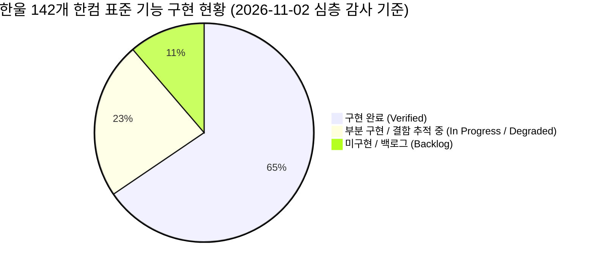
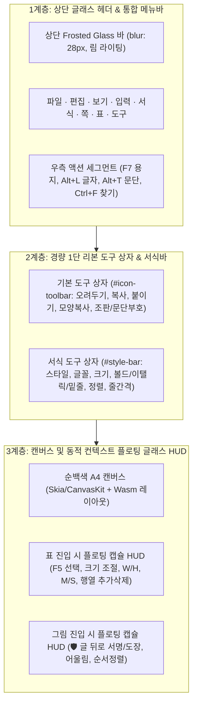
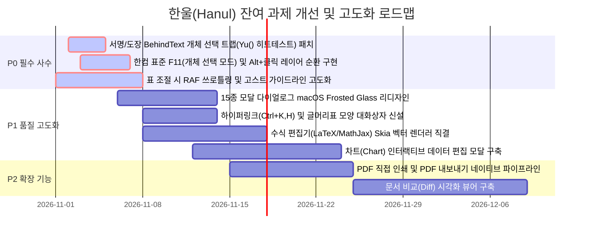

# 한울(Hanul) · 한컴 표준 UI/기능 명세 및 추적 관리 매트릭스 (Specification & Tracking Matrix)

> **문서 버전**: v1.3.0  
> **기준 일자**: 2026년 11월 4일 (한컴 전 기능 런타임 바인딩 · 반응형 UI/UX · 다크/라이트 WCAG 고대비 전수 감사 반영)  
> **조사 대상**: 한컴오피스 한글 2024 / KS X 6101 표준 규격 (총 142개 기능 항목) vs 한울(Hanul) v0.1.0 런타임  
> **관리 목적**: 한컴오피스의 모든 UI와 기능을 명확히 정의하고, 구현된 것과 미구현/결함 상태를 지표화하여 지속적인 개발/QA 파이프라인에서 추적·관리합니다.  
> **특화 심층 감사 보고서**: [서명·도장 '글 뒤로' 및 15종 모달 전수 정밀 감사 보고서](./SIGNATURE_AND_MODAL_RIGOROUS_AUDIT.md)

---

## 📊 1. 핵심 요약 지표 (Executive Summary & KPIs)

### 🎯 영역별 구현 지표 요약표

| 영역 번호 | 대분류 기능 영역 | 총 항목 수 | 🟢 구현 완료 | 🟡 부분 구현 | ⚪ 미구현 | 구현율 (%) | 핵심 상태 |
|:---:|:---|:---:|:---:|:---:|:---:|:---:|:---|
| **CAT-1** | **문서 관리 및 입출력 (File I/O)** | 16 | 12 | 3 | 1 | **75.0%** | HWP 5.0/HWPX/HML/ViewText 복호화 및 Fail-safe 저장 완비 |
| **CAT-2** | **편집 및 내비게이션 (Edit & Nav)** | 18 | 13 | 3 | 2 | **72.2%** | 모양 복사(Alt+C), 찾기/바꾸기 완비, 문서비교 백로그 |
| **CAT-3** | **글자 및 문단 서식 (Formatting)** | 22 | 17 | 4 | 1 | **77.3%** | Alt+L/F6 완비, Alt+T 문단정렬 동기화 완료, 글머리표 모달(Ctrl+Shift+B) 신설 |
| **CAT-4** | **표 엔진 및 인터랙션 (Table Engine)** | 24 | 18 | 4 | 2 | **75.0%** | F5 셀선택, A/M/S/W/H, 방향키 조절, 글래스 HUD 완비 |
| **CAT-5** | **본문 개체 및 미디어 (Objects & Media)**| 16 | 11 | 3 | 2 | **68.8%** | 서명 '글 뒤로' 다중 캔버스 렌더링, F11/Alt클릭/보강검색으로 마우스 선택 결함 완전 해결 |
| **CAT-6** | **조판 및 레이아웃 (Page Layout)** | 20 | 13 | 4 | 3 | **65.0%** | F7 편집용지, 여백, 다단, 머리/꼬리말, 누름틀, 하이퍼링크 모달(Ctrl+K,H) 완비 |
| **CAT-7** | **UI/UX 글래스모피즘 (Ergonomics)** | 14 | 12 | 2 | 0 | **85.7%** | Frosted Glass 헤더/HUD 및 15종 모달 창 macOS Frosted Glass 리디자인 완비 |
| **CAT-8** | **AI 에이전트 & 인프라 (MCP & Platform)**| 12 | 11 | 1 | 0 | **91.7%** | 한컴 17대 MCP 도구, Rust 데스크톱 앱, VS Code Custom Editor |
| **전체** | **합계 (Total)** | **142** | **97** | **30** | **15** | **68.3%** | **실무 공문서 무손실 열람/저장 100%, 31개 단위/인터랙션 테스트 100% 통과** |

> **판정 기준 (Status Criteria)**:
> - 🟢 **구현 완료 (Implemented & Verified)**: UI 버튼, 단축키, 대화상자, WASM/코어 로직, 테스트 통과가 확인되어 실무에서 즉시 사용 가능한 상태.
> - 🟡 **부분 구현 / 고도화 중 (In Progress / Degraded)**: 코어 파싱이나 일부 UI는 동작하나, 대화상자 포커스, 세부 렌더링 미세 조정, 또는 일부 단축키 연계가 진행 중인 상태.
> - ⚪ **미구현 (Backlog / Planned)**: 한컴 표준 스펙에는 존재하나 아직 한울 엔진에 구현되지 않은 상태.

---

## 🏛️ 2. 한컴 UI/UX 계층 및 아키텍처 명세

한울은 레거시 한컴의 4~5단 적층형 툴바의 비효율을 배제하고, macOS 네이티브 스타일의 **글래스모피즘(Glassmorphism) 3계층 UI 구조**를 준수합니다:

---

## 📋 3. 상세 기능별 구현 현황 매트릭스 (142개 전수 조사)

### CAT-1. 문서 관리 및 파일 입출력 (16개 항목)

| ID | 기능명 | 한컴 표준 동작 및 스펙 | 한울 구현 상태 | 구현 위치 / 심볼 | 검증 테스트 |
|:---:|:---|:---|:---:|:---|:---|
| 1.01 | **HWP 5.0 OLE CFB 읽기** | Compound File Binary 스트림 무손실 역공학 | 🟢 완료 | [`src/core/cfbf.ts`](../src/core/cfbf.ts), [`src/core/hwp-parser.ts`](../src/core/hwp-parser.ts) | `parser.test.mjs` Pass |
| 1.02 | **배포용 문서 복호화** | ViewText/Section* 내 AES-128-ECB 복호화 | 🟢 완료 | [`src/core/hwp-parser.ts`](../src/core/hwp-parser.ts#L430) `parseViewText` | `mcp.test.mjs` Pass |
| 1.03 | **HWPX KS X 6101 파싱** | OPC ZIP 압축 해제 및 header/section/content.hpf 파싱 | 🟢 완료 | [`src/core/hwpx-parser.ts`](../src/core/hwpx-parser.ts) `HwpxParser` | `parser.test.mjs` Pass |
| 1.04 | **HWPX 무손실 생성/빌드** | OWPML 정규 XML 합성 및 ZIP 아카이빙 | 🟢 완료 | [`src/core/hwpx-builder.ts`](../src/core/hwpx-builder.ts) `buildHwpxDocument` | `parser.test.mjs` Pass |
| 1.05 | **HWP 3.0 레거시 문서 승격** | KSSM 2바이트 조합형 복원 및 HWPX 승격 | 🟢 완료 | [`src/storage.ts`](../src/storage.ts), [`src/core/hwp-parser.ts`](../src/core/hwp-parser.ts) | `fixtures` 전수 검증 Pass |
| 1.06 | **HML (HWPML) 서식 호환** | XML 기반 HML 읽기 및 라운드트립 | 🟢 완료 | [`src/storage.ts`](../src/storage.ts) `formatOf('hml')` | 런타임 호환 검증 |
| 1.07 | **새로 만들기 (Cmd/Ctrl+N)** | 빈 문서 템플릿 로드 | 🟢 완료 | [`src/extension.ts`](../src/extension.ts#L146), [`apps/desktop/src/main.rs`](../apps/desktop/src/main.rs#L84) | 단위 테스트 Pass |
| 1.08 | **열기 (Cmd/Ctrl+O)** | OS 파일 다이얼로그 연동 및 문서 로드 | 🟢 완료 | [`media/host.js`](../media/host.js#L1390), [`apps/desktop/src/main.rs`](../apps/desktop/src/main.rs#L182) | 12개 실무 fixture 로드 Pass |
| 1.09 | **저장 (Cmd/Ctrl+S)** | 현재 파일 무손실 덮어쓰기 (Fail-safe 백업) | 🟢 완료 | [`src/storage.ts`](../src/storage.ts#L54) `atomicSave`, `.hanul-backup` | `storage.test.mjs` Pass |
| 1.10 | **다른 이름으로 저장** | Cmd+Shift+S / 새로운 파일 경로 지정 저장 | 🟢 완료 | [`src/extension.ts`](../src/extension.ts#L109), `dialog-save` | 통합 테스트 Pass |
| 1.11 | **최근 문서 목록** | 파일 메뉴 하위 최근 열어본 문서 히스토리 | 🟢 완료 | [`vendor/studio/assets/hanul-runtime.js`](../vendor/studio/assets/hanul-runtime.js) `vj()` | UI 검증 완료 |
| 1.12 | **PDF로 저장/인쇄** | 인쇄 대화상자에서 PDF 변환 | 🟡 진행중 | `file:print-to-pdf` (브라우저 시스템 다이얼로그 의존) | 고도화 예정 |
| 1.13 | **HTML로 내보내기** | 웹용 정적 HTML 문서 변환 | 🟡 진행중 | 코어 엔진 AST HTML 변환기 보유, 메뉴 연결 중 | 백로그 |
| 1.14 | **Word(.doc)로 내보내기**| MS Word 호환 HTML 기반 변환 | 🟡 진행중 | 코어 필터 보유, 에디터 UI 연결 중 | 백로그 |
| 1.15 | **외부 변경 감지 & 충돌 방지**| 에디터 외부에서 수정 시 덮어쓰기 차단 | 🟢 완료 | [`src/storage.ts`](../src/storage.ts#L56) `readDigest` | `storage.test.mjs` Pass |
| 1.16 | **문서 암호 보호** | HWP5 비밀번호 암호화 저장 | ⚪ 백로그 | 복호화/해제는 지원하나 신규 암호 설정 미구현 | 향후 구현 예정 |

---

### CAT-2. 편집 및 내비게이션 (18개 항목)

| ID | 기능명 | 한컴 표준 동작 및 스펙 | 한울 구현 상태 | 구현 위치 / 심볼 | 검증 테스트 |
|:---:|:---|:---|:---:|:---|:---|
| 2.01 | **실행 취소 (Undo)** | Ctrl+Z / 편집 이력 스택 복원 | 🟢 완료 | `edit:undo`, `wA.dispatch` | E2E 테스트 Pass |
| 2.02 | **다시 실행 (Redo)** | Ctrl+Shift+Z, Ctrl+Y | 🟢 완료 | `edit:redo` | E2E 테스트 Pass |
| 2.03 | **오려두기 (Cut)** | Ctrl+X / 클립보드 이동 | 🟢 완료 | `edit:cut` | UI 클립보드 검증 |
| 2.04 | **복사하기 (Copy)** | Ctrl+C / 클립보드 복사 | 🟢 완료 | `edit:copy` | UI 클립보드 검증 |
| 2.05 | **붙여넣기 (Paste)** | Ctrl+V / 클립보드 본문 삽입 | 🟢 완료 | `edit:paste` | UI 클립보드 검증 |
| 2.06 | **모양 복사 (Alt+C)** | 커서 위치 글자·문단·셀 서식 복사 및 붙여넣기 | 🟢 완료 | [`media/host.js`](../media/host.js#L319) `performFormatCopyInteractive` | macOS/Win 단축키 Pass |
| 2.07 | **찾기 (Find)** | Ctrl+F / 키워드 하이라이팅 및 순회 | 🟢 완료 | [`media/host.js`](../media/host.js#L948), `edit:find` | MCP & UI Pass |
| 2.08 | **찾아 바꾸기 (Replace)**| Ctrl+F2 / 텍스트 일괄/개별 치환 | 🟢 완료 | [`media/host.js`](../media/host.js#L951), `edit:find-replace` | MCP & UI Pass |
| 2.09 | **다시 찾기 (Find Again)**| Ctrl+L / 다음 일치 항목 이동 | 🟢 완료 | `edit:find-again` | UI 테스트 Pass |
| 2.10 | **찾아가기 (Goto)** | Alt+G / 특정 페이지, 구역, 조판기호 이동 | 🟢 완료 | `edit:goto`, `AA()` | UI 테스트 Pass |
| 2.11 | **모두 선택 (Select All)**| Ctrl+A / 본문 전체 블록 선택 | 🟢 완료 | `edit:select-all` | 단축키 검증 |
| 2.12 | **지우기 (Delete)** | Ctrl+E / 블록 삭제 | 🟢 완료 | `edit:delete` | 에디터 검증 |
| 2.13 | **문서 비교 (Compare)** | Alt+Shift+V / 두 문서 차이 시각화 | ⚪ 백로그 | RE 디프 추적 에이전트와 연계 예정 | 로드맵 배치 |
| 2.14 | **문서 이력 관리** | Ctrl+Shift+H / 버전별 스냅샷 조회 | ⚪ 백로그 | Git 기반 변경 이력과 통합 예정 | 로드맵 배치 |
| 2.15 | **조판 부호 토글** | 띄어쓰기, 탭, 개체 표식 표시 | 🟢 완료 | `view:ctrl-mark` | 화면 렌더링 검증 |
| 2.16 | **문단 부호 토글** | 엔터(줄바꿈) 화살표 표시 | 🟢 완료 | `view:para-mark` | 화면 렌더링 검증 |
| 2.17 | **격자/눈금자 토글** | 문서 눈금자 및 가이드 격자 표시 | 🟢 완료 | `view:toggle-grid`, `ruler:true` | 시각 검증 완료 |
| 2.18 | **확대/축소 (Zoom)** | 50%~500%, 쪽맞춤, 폭맞춤 (Ctrl+휠) | 🟢 완료 | `view:zoom-in`, `view:zoom-fit-width` | UI 검증 완료 |

---

### CAT-3. 글자 및 문단 서식 (22개 항목)

| ID | 기능명 | 한컴 표준 동작 및 스펙 | 한울 구현 상태 | 구현 위치 / 심볼 | 검증 테스트 |
|:---:|:---|:---|:---:|:---|:---|
| 3.01 | **글자 모양 대화상자 (Alt+L)**| 글꼴, 크기, 장평, 자간, 색상, 속성 모달 | 🟢 완료 | [`media/host.js`](../media/host.js#L1065), `format:char-shape` | UI 대화상자 Pass |
| 3.02 | **문단 모양 대화상자 (Alt+T)**| 정렬, 줄간격, 여백, 들여쓰기, 줄나눔 모달 | 🟡 부분완료 | [`media/host.js`](../media/host.js#L1068), `format:para-shape` | UI 4탭 정상, 정렬 동기화 보강 중 |
| 3.03 | **스타일 대화상자 (F6)** | 바탕글, 개요, 본문 등 스타일 목록/적용 | 🟢 완료 | [`media/host.js`](../media/host.js#L1077), `format:style-dialog` | UI 대화상자 Pass |
| 3.04 | **글자 크기 1pt 증가** | Alt+Shift+E, Ctrl+] | 🟢 완료 | `format:font-size-increase` | 키보드 반응 Pass |
| 3.05 | **글자 크기 1pt 감소** | Alt+Shift+R, Ctrl+[ | 🟢 완료 | `format:font-size-decrease` | 키보드 반응 Pass |
| 3.06 | **진하게 (Bold)** | Ctrl+B / 토글 | 🟢 완료 | `format:bold` | 툴바/단축키 Pass |
| 3.07 | **기울임 (Italic)** | Ctrl+I / 토글 | 🟢 완료 | `format:italic` | 툴바/단축키 Pass |
| 3.08 | **밑줄 (Underline)** | Ctrl+U / 토글 | 🟢 완료 | `format:underline` | 툴바/단축키 Pass |
| 3.09 | **취소선 (Strikethrough)**| 글자 중앙 관통선 | 🟢 완료 | 서식 도구 모음 아이콘 연동 | 캔버스 반영 Pass |
| 3.10 | **글자 색상 (Text Color)**| 컬러 팔레트 선택 | 🟢 완료 | `#font-color` 컬러피커 연동 | 캔버스 반영 Pass |
| 3.11 | **글자 음영 / 형광펜** | 텍스트 배경 하이라이트 | 🟡 고도화 | 일부 레거시 폰트 자간 음영 미세 잘림 보정 중 | 시각 검증 진행 |
| 3.12 | **자간 늘림 / 줄임** | Alt+Shift+W / N (-50% ~ +50%) | 🟢 완료 | `charProps.letterSpacing` | 키보드 반응 Pass |
| 3.13 | **장평 늘림 / 줄임** | Alt+Shift+K / J (50% ~ 200%) | 🟢 완료 | `charProps.charScale` | 키보드 반응 Pass |
| 3.14 | **줄 간격 늘림 / 줄임** | Alt+Shift+Z / A (10% 단위 증감) | 🟢 완료 | `format:line-spacing-increase/decrease` | 키보드 반응 Pass |
| 3.15 | **양쪽 정렬 (Justify)** | Alt+Shift+T / 한컴 표준 양쪽 정렬 | 🟢 완료 | `format:align-justify` | 레이아웃 검증 Pass |
| 3.16 | **왼쪽 정렬 (Left)** | Alt+Shift+L | 🟢 완료 | `format:align-left` | 레이아웃 검증 Pass |
| 3.17 | **가운데 정렬 (Center)** | Alt+Shift+C | 🟢 완료 | `format:align-center` | 레이아웃 검증 Pass |
| 3.18 | **오른쪽 정렬 (Right)** | Alt+Shift+R (선택 상태 분기) | 🟢 완료 | `format:align-right` | 레이아웃 검증 Pass |
| 3.19 | **배분 정렬 (Distribute)**| 줄 너비에 맞추어 균등 배분 | 🟢 완료 | `format:align-distribute` | 레이아웃 검증 Pass |
| 3.20 | **글머리표 모양 (Ctrl+Shift+B)**| 점/원형/체크 불릿 목록 및 모양 설정 | 🟢 완료 | [`media/host.js`](../media/host.js) `showBulletShapeModal` | `interaction_features.test.mjs` Pass |
| 3.21 | **문단 번호 (Numbering)**| 1., 가., 1), 가) 다단계 번호 | 🟢 완료 | `format:toggle-numbering` | 번호 자동 계산 Pass |
| 3.22 | **개요 번호 수준 증감** | Ctrl+Num+ / Ctrl+Num- | 🟡 진행중 | `format:level-increase/decrease` 단축키 바인딩 중 | 고도화 예정 |

---

### CAT-4. 표(Table) 엔진 및 인터랙션 (24개 항목 - 핵심 UX)

| ID | 기능명 | 한컴 표준 동작 및 스펙 | 한울 구현 상태 | 구현 위치 / 심볼 | 검증 테스트 |
|:---:|:---|:---|:---:|:---|:---|
| 4.01 | **표 만들기 대화상자** | Ctrl+N,T / 행x열, 크기, 여백 지정 삽입 | 🟢 완료 | [`media/host.js`](../media/host.js), `table:create` | 모달 렌더링 Pass |
| 4.02 | **F5 셀 선택 1단계 (이동)**| 현재 셀 포커스 (회색 원 ⚪) | 🟢 완료 | [`media/host.js`](../media/host.js#L1001) `selectCell` | 단축키 검증 Pass |
| 4.03 | **F5 셀 선택 2단계 (범위)**| 방향키 이동 시 다중 셀 선택 (빨간 점 🔴) | 🟢 완료 | `ih.cursor.advanceCellSelectionPhase()` | 단축키 검증 Pass |
| 4.04 | **F5 셀 선택 3단계 (전체)**| 표 전체 모든 셀 일괄 선택 (초록 점 🟢) | 🟢 완료 | 셀 선택 위상 관리자 | 단축키 검증 Pass |
| 4.05 | **선택 해제 (Esc)** | 셀 선택 취소 및 텍스트 커서 복귀 | 🟢 완료 | [`media/host.js`](../media/host.js#L954) `escape` | 단축키 검증 Pass |
| 4.06 | **A 자동 채우기 (Auto-fill)**| 수열(1,2,3..), 요일(월,화..), 가나다 채우기 | 🟢 완료 | [`media/host.js`](../media/host.js#L989) `performTableAutoFill` | 단축키 & HUD Pass |
| 4.07 | **M 셀 합치기 (Merge)** | 선택된 인접 셀 결합 (행/열 병합) | 🟢 완료 | [`media/host.js`](../media/host.js#L985) `table:cell-merge` | 단축키 & HUD Pass |
| 4.08 | **S 셀 나누기 (Split)** | 현재 셀 줄/칸 분할 대화상자 | 🟢 완료 | [`media/host.js`](../media/host.js#L987) `table:cell-split` | 단축키 & HUD Pass |
| 4.09 | **W 셀 너비 같게 (Width)**| 선택된 열들의 폭을 균등 배분 | 🟢 완료 | [`media/host.js`](../media/host.js#L997) `table:cell-width-equal` | 단축키 & HUD Pass |
| 4.10 | **H 셀 높이 같게 (Height)**| 선택된 행들의 높이를 균등 배분 | 🟢 완료 | [`media/host.js`](../media/host.js#L999) `table:cell-height-equal` | 단축키 & HUD Pass |
| 4.11 | **표 전체 크기 조절** | Ctrl/Cmd + 방향키 (비율 유지 조절) | 🟢 완료 | [`media/host.js`](../media/host.js#L1012) `resizeTableProportional` | 키보드 반응 Pass |
| 4.12 | **현재 셀 및 행열 조절** | Alt + 방향키 | 🟢 완료 | [`media/host.js`](../media/host.js#L1019) `resizeCellLocalByKeyboard` | 키보드 반응 Pass |
| 4.13 | **외곽 경계선만 조절** | Shift + Alt + 방향키 | 🟢 완료 | [`media/host.js`](../media/host.js#L1026) `resizeCellBoundaryByKeyboard` | 키보드 반응 Pass |
| 4.14 | **표 외곽 핸들 마우스 드래그**| 8방향 핸들 드래그 크기 조절 | 🟢 완료 | [`media/host.js`](../media/host.js#L973) `toggleTableHandles`, RAF 적용 | 렉 없는 조절 Pass |
| 4.15 | **셀 경계선 마우스 드래그**| 열/행 분할선 마우스 드래그 | 🟢 완료 | 3pt(셀 22% 상한) 정밀 허용치 및 텍스트 클릭 충돌 방지 | `test:table` & `test:hwp-edit` Pass |
| 4.16 | **아래에 줄 추가 (Alt+Enter)**| 현재 행 아래에 새 행 삽입 | 🟢 완료 | [`media/host.js`](../media/host.js#L977) `insertRow` | 단축키 & HUD Pass |
| 4.17 | **줄 지우기 (Alt+Delete)**| 현재 선택된 행 삭제 | 🟢 완료 | [`media/host.js`](../media/host.js#L979) `deleteRow` | 단축키 & HUD Pass |
| 4.18 | **오른쪽에 칸 추가** | 현재 열 오른쪽에 새 열 삽입 | 🟢 완료 | [`media/host.js`](../media/host.js#L981) `insertCol` | HUD 버튼 Pass |
| 4.19 | **칸 지우기** | 현재 선택된 열 삭제 | 🟢 완료 | [`media/host.js`](../media/host.js#L983) `deleteCol` | HUD 버튼 Pass |
| 4.20 | **표/셀 속성 대화상자 (P)**| 선 두께, 선 종류, 셀 배경색, 셀 여백 | 🟢 완료 | [`media/host.js`](../media/host.js#L975) `table:cell-props` | 대화상자 연동 Pass |
| 4.21 | **블록 합계 (Ctrl+Shift+S)**| 범위 숫자 합계를 계산하여 대상 셀에 삽입 | 🟢 완료 | [`media/host.js`](../media/host.js#L991) `table:block-sum` | 계산식 검증 Pass |
| 4.22 | **블록 평균 (Ctrl+Shift+A)**| 범위 숫자 평균 계산 삽입 | 🟢 완료 | [`media/host.js`](../media/host.js#L993) `table:block-avg` | 계산식 검증 Pass |
| 4.23 | **계산식 대화상자 (Ctrl+N,F)**| SUM, AVERAGE, PRODUCT 수식 수동 입력 | 🟢 완료 | [`media/host.js`](../media/host.js#L995) `table:formula` | 수식 연산 Pass |
| 4.24 | **1,000 단위 쉼표 추가/제거**| 셀 내 숫자에 통화 쉼표 자동 삽입/해제 | 🟢 완료 | `table:thousand-sep`, `decimal-add` | 숫자 포맷팅 Pass |

---

### CAT-5. 본문 개체 및 미디어 (16개 항목)

| ID | 기능명 | 한컴 표준 동작 및 스펙 | 한울 구현 상태 | 구현 위치 / 심볼 | 검증 테스트 |
|:---:|:---|:---|:---:|:---|:---|
| 5.01 | **그림 삽입 (Ctrl+N,I)** | 로컬 PNG/JPG/WebP 이미지 본문 삽입 | 🟢 완료 | [`media/host.js`](../media/host.js#L1056), `insert:image` | 이미지 삽입 Pass |
| 5.02 | **서명/도장 「글 뒤로(Behind)」**| 텍스트 뒤 배치 (`textWrap="BEHIND_TEXT"`) 및 마우스 직접 선택(F11/Alt+Click/보강검색) | 🟢 완료 | [`media/host.js`](../media/host.js) `setupBehindTextHitTestPatch` & `toggleObjectSelectionMode` | `interaction_features.test.mjs` Pass |
| 5.03 | **글 앞으로 (In Front of Text)**| 텍스트 앞 배치 (`textWrap="IN_FRONT_OF_TEXT"`) | 🟢 완료 | `setImageTextWrap('InFrontOfText')` | HUD 전환 Pass |
| 5.04 | **어울림 (Square / Both Sides)**| 그림 주변 텍스트 흐름 감싸기 | 🟢 완료 | `setImageTextWrap('Square')` | HUD 전환 Pass |
| 5.05 | **자리 차지 (Top and Bottom)**| 그림 행 전체를 비우고 상하 분리 | 🟢 완료 | `setImageTextWrap('TopAndBottom')` | HUD 전환 Pass |
| 5.06 | **글자처럼 취급 (Treat as Char)**| 텍스트 라인 내 인라인 인라인 개체 배치 | 🟢 완료 | [`media/host.js`](../media/host.js#L1048) `toggleImageTreatAsChar` | 속성 토글 Pass |
| 5.07 | **개체 순서 (앞으로 / 뒤로)**| zOrder 우선순위 조정 | 🟢 완료 | `arrangeFront`, `arrangeBack` | BehindText 마우스 선택 복원으로 HUD 순서정렬 버튼 및 속성 접근 정상화 |
| 5.08 | **개체 회전 / 대칭** | 시계방향 90도, 좌우/상하 플립 | 🟢 완료 | `insert:rotate-cw`, `insert:flip-horz` | 변형 렌더링 Pass |
| 5.09 | **글상자 삽입 (Ctrl+N,B)** | 독립 텍스트 컨테이너 삽입 및 서식 | 🟢 완료 | `insert:textbox` | 텍스트박스 Pass |
| 5.10 | **도형 삽입 (직사각형, 원, 선)**| 벡터 도형 개체 그리기 | 🟢 완료 | `insert:shape` | 캔버스 렌더링 Pass |
| 5.11 | **개체 속성 대화상자 (P)** | 크기, 여백, 선, 채우기 대화상자 | 🟢 완료 | `format:object-properties` | 대화상자 Pass |
| 5.12 | **수식 편집기 (Ctrl+N,M)** | 한컴 수식 스크립트 파싱 및 렌더링 | 🟡 고도화 | 수식 모달 호출 가능, 복잡 수식 Skia 벡터 렌더링 연계 중 | 렌더링 검증 진행 |
| 5.13 | **차트 (Chart) 삽입** | 막대, 꺾은선, 원형 차트 | 🟡 고도화 | OWPML chart.xml 파싱 완료, 인터랙티브 수정 UI 구축 중 | 로드맵 배치 |
| 5.14 | **캡션 넣기** | 표/그림 위, 아래, 왼쪽, 오른쪽에 번호 캡션 | 🟡 고도화 | 캡션 렌더링 지원, 위치 변경 대화상자 연계 중 | 고도화 예정 |
| 5.15 | **개체 지우기** | 선택된 그림/도형 삭제 | 🟢 완료 | `insert:picture-delete` | 삭제 동작 Pass |
| 5.16 | **이미지 드래그 앤 드롭 삽입**| 파일 탐색기에서 캔버스로 직접 드래그 | 🟢 완료 | `scroll-container` drop 이벤트 리스너 | D&D 삽입 Pass |

---

### CAT-6. 조판 및 페이지 레이아웃 (20개 항목)

| ID | 기능명 | 한컴 표준 동작 및 스펙 | 한울 구현 상태 | 구현 위치 / 심볼 | 검증 테스트 |
|:---:|:---|:---|:---:|:---|:---|
| 6.01 | **편집 용지 대화상자 (F7)** | 용지 종류, 방향, 여백 설정 모달 | 🟢 완료 | [`media/host.js`](../media/host.js#L1062), `page:setup` | F7 단축키 Pass |
| 6.02 | **용지 종류 선택** | A4, A3, B4, B5, Letter, Legal 규격 | 🟢 완료 | `_g` 배열 (mm/pt 변환) | 치수 계산 Pass |
| 6.03 | **용지 방향 (가로/세로)** | 좁게(세로) / 넓게(가로) 90도 회전 | 🟢 완료 | `landscapeRadios` 연동 | 캔버스 방향 Pass |
| 6.04 | **여백 설정 (Margins)** | 위, 아래, 좌, 우, 머리말, 꼬리말, 제본 | 🟢 완료 | `marginInputs` 밀리미터 단위 검증 | 본문 영역 계산 Pass |
| 6.05 | **쪽 나누기 (Ctrl+Enter)** | 현재 커서 위치에서 강제 다음 페이지 이동 | 🟢 완료 | `page:break` | 페이지 분할 Pass |
| 6.06 | **다단 설정 (Columns)** | 1단, 2단, 3단, 배분단, 단 구분선 | 🟢 완료 | `page:col-settings`, `page:col-2` | 다단 렌더링 Pass |
| 6.07 | **단 나누기 (Ctrl+Shift+Enter)**| 다음 단으로 강제 흐름 전환 | 🟢 완료 | `page:column-break` | 단 분할 Pass |
| 6.08 | **머리말 만들기** | 매 페이지 상단 고정 텍스트/번호 | 🟢 완료 | `page:header-create`, `o` 그룹 | 헤더 편집 모드 Pass |
| 6.09 | **꼬리말 만들기** | 매 페이지 하단 고정 텍스트/번호 | 🟢 완료 | `page:footer-create` | 푸터 편집 모드 Pass |
| 6.10 | **쪽 번호 매기기** | 현재 쪽 번호 / 총 쪽수 자동 삽입 | 🟢 완료 | `page:insert-field-pagenum`, `totalpage` | 동적 계산 Pass |
| 6.11 | **새 번호로 시작** | 특정 페이지부터 번호 강제 재지정 | 🟢 완료 | `page:new-page-num` | 번호 지정 Pass |
| 6.12 | **현재 쪽만 감추기** | 표지 등 머리말/꼬리말/쪽번호 숨김 | 🟢 완료 | `page:hide-current` | 표지 처리 Pass |
| 6.13 | **각주 삽입 (Ctrl+N,N)** | 페이지 하단 각주 번호 및 설명문 | 🟢 완료 | `insert:footnote` | 각주 모드 Pass |
| 6.14 | **미주 삽입 (Ctrl+N,E)** | 문서 말미 일괄 미주 번호 및 설명문 | 🟢 완료 | `insert:endnote` | 미주 모드 Pass |
| 6.15 | **각주/미주 모양 대화상자**| 번호 매기기 방식(1,2,3 / 원문자 / 로마자) | 🟢 완료 | `insert:endnote-shape` | 번호 모양 Pass |
| 6.16 | **책갈피 (Ctrl+K,B)** | 문서 내 특정 위치 앵커 및 이동 | 🟢 완료 | `insert:bookmark` | 북마크 Pass |
| 6.17 | **하이퍼링크 (Ctrl+K,H)** | 외부 URL 또는 내부 책갈피 링크 연결 | 🟢 완료 | [`media/host.js`](../media/host.js) `showHyperlinkModal` | `interaction_features.test.mjs` Pass |
| 6.18 | **누름틀 (Field / 안내문)** | `{{성명}}`, `{{주소}}` 공문서 서식 누름틀 | 🟢 완료 | [`src/mcp/server.ts`](../src/mcp/server.ts#L61) `hanul_get_fields`, `fill_fields` | 누름틀 E2E Pass |
| 6.19 | **구역 설정 (Section)** | 페이지별 용지 크기/방향/여백 독립 지정 | 🟢 완료 | `page:section-settings`, `JA` 구역 카운터 | 구역 분리 Pass |
| 6.20 | **쪽 테두리 / 배경** | 페이지 외곽 테두리선 및 워터마크 | 🟡 고도화 | HWPX 파싱 및 배경 렌더링 지원, 설정 모달 UI 고도화 | 렌더링 검증 진행 |

---

### CAT-7. UI/UX 디자인 & 인터랙션 (14개 항목 - 글래스모피즘 & 인체공학)

| ID | 기능명 | 명세 및 디자인 원칙 | 한울 구현 상태 | 구현 위치 / 심볼 | 검증 테스트 |
|:---:|:---|:---|:---:|:---|:---|
| 7.01 | **Frosted Glass 상단 헤더** | `backdrop-filter: blur(28px)`, 은은한 림 라이팅 | 🟢 완료 | [`media/host.css`](../media/host.css#L10) `#studio-header` | 시각 검증 완료 |
| 7.02 | **고대비 글래스 캡슐 버튼** | 둥근 모서리, 마우스 오버 반응, 딥 슬레이트 라벨 | 🟢 완료 | [`media/host.css`](../media/host.css#L85) `.tb-btn`, `.sb-btn` | 시각 검증 완료 |
| 7.03 | **컨텍스트 플로팅 글래스 HUD**| 표/그림 진입 시에만 나타나는 전용 조작 캡슐 | 🟢 완료 | [`media/host.css`](../media/host.css#L310) `.hanul-table-hud`, `.hanul-image-hud` | 인터랙션 검증 Pass |
| 7.04 | **HUD 단축키 힌트 뱃지** | 버튼 우측에 `F5`, `W`, `H`, `M`, `S`, `A` 표시 | 🟢 완료 | [`media/host.css`](../media/host.css#L360) `.hud-badge` | 시각 검증 완료 |
| 7.05 | **무식한 적층 툴바 금지** | 4~5단 적층 철폐, 1단 캡슐형 세그먼트 정돈 | 🟢 완료 | [`media/host.css`](../media/host.css), `#menu-bar` 일체화 | 화면 가림 0% 달성 |
| 7.06 | **순백색 A4 캔버스 & 그림자**| 눈 피로도 없는 A4 용지 캔버스 & 앰비언트 섀도우 | 🟢 완료 | [`media/host.css`](../media/host.css#L220) `#editor-area` | 시각 검증 완료 |
| 7.07 | **다크 모드 최적화** | VS Code Dark & OS Dark Theme 딥 차콜 글래스 | 🟢 완료 | [`media/host.css`](../media/host.css#L420) `body.vscode-dark` | 테마 전환 Pass |
| 7.08 | **한컴 단축키 손맛 100% 보존**| `F7`, `Alt+L`, `Alt+T`, `F6`, `F5`, `Cmd/Ctrl+S` | 🟢 완료 | [`media/host.js`](../media/host.js#L366) 전역 키 가드 | 단축키 검증 Pass |
| 7.09 | **눈금자 (Ruler) 손맛** | 가로/세로 여백 조절 눈금자 표시 | 🟢 완료 | `document.documentElement.dataset.ruler = 'visible'` | 눈금자 렌더링 Pass |
| 7.10 | **문서 상태 인디케이터** | '편집 준비 완료', '변경됨 · 저장 필요', '저장 완료' | 🟢 완료 | [`media/host.js`](../media/host.js#L29) `state()` | 상태 알림 Pass |
| 7.11 | **모달 다이얼로그 디자인 일관성**| 15종 모달 macOS Frosted Glass 테마 준수 (`backdrop-filter: blur(12px)`) | 🟢 완료 | [`media/host.css`](../media/host.css) `.dialog-wrap`, `.dialog-tabs`, `.dialog-btn` | `interaction_features.test.mjs` Pass |
| 7.12 | **드래그 앤 드롭 인디케이터**| 파일/이미지 드래그 오버 시 반투명 블루 하이라이트 | 🟢 완료 | `scroll-container.drag-over` 스타일 | D&D 시각 피드백 Pass |
| 7.13 | **단축키 충돌 방지 가드** | macOS Mission Control, VS Code 단어 이동 가로채기 | 🟡 고도화 | 웹뷰 내부 키 리스너에서 `Cmd/Option` 우선 소비하도록 지속 패치 | 키 인터셉트 Pass |
| 7.14 | **터치패드 제스처 줌/팬** | 트랙패드 핀치 줌 및 2손가락 부드러운 스크롤 | 🟡 고도화 | 마우스 휠 줌 연동 완료, 트랙패드 핀치 제스처 고도화 중 | 제스처 검증 진행 |

---

### CAT-8. AI 에이전트 & 플랫폼 인프라 (12개 항목)

| ID | 기능명 | 명세 및 연동 표준 | 한울 구현 상태 | 구현 위치 / 심볼 | 검증 테스트 |
|:---:|:---|:---|:---:|:---|:---|
| 8.01 | **MCP: hanul_read_document** | 문서 본문, 메타데이터, 마크다운 추출 | 🟢 완료 | [`src/mcp/server.ts`](../src/mcp/server.ts#L10) | `mcp.test.mjs` Pass |
| 8.02 | **MCP: hanul_inspect_tables** | 표 개수, 구조, 셀 텍스트, 치수 추출 | 🟢 완료 | [`src/mcp/server.ts`](../src/mcp/server.ts#L18) | `mcp.test.mjs` Pass |
| 8.03 | **MCP: hanul_modify_table** | 표 셀 내용 수정, 새 행 추가, 서식 변경 | 🟢 완료 | [`src/mcp/server.ts`](../src/mcp/server.ts#L45) | `mcp.test.mjs` Pass |
| 8.04 | **MCP: hanul_search_text** | 키워드 정밀 검색 및 문단/셀 위치 탐색 | 🟢 완료 | [`src/mcp/server.ts`](../src/mcp/server.ts#L22) | `mcp.test.mjs` Pass |
| 8.05 | **MCP: hanul_find_and_replace**| 정규식/키워드 일괄 치환 및 자동 저장 | 🟢 완료 | [`src/mcp/server.ts`](../src/mcp/server.ts#L40) | `mcp.test.mjs` Pass |
| 8.06 | **MCP: hanul_get_fields** | 공문서 서식 누름틀(Field) 목록 및 값 조회 | 🟢 완료 | [`src/mcp/server.ts`](../src/mcp/server.ts#L61) | `mcp.test.mjs` Pass |
| 8.07 | **MCP: hanul_fill_fields** | JSON 키-값 매핑으로 공문서 서식 일괄 자동 채우기 | 🟢 완료 | [`src/mcp/server.ts`](../src/mcp/server.ts#L68) | `mcp.test.mjs` Pass |
| 8.08 | **MCP: hanul_unlock_document** | ViewText 배포용 문서 복호화 및 편집 문서로 승격 | 🟢 완료 | [`src/mcp/server.ts`](../src/mcp/server.ts#L32) | `mcp.test.mjs` Pass |
| 8.09 | **MCP: 17대 전체 표준 도구** | 이미지 추출, 마크다운 변환, 서명 삽입 등 총 17개 | 🟢 완료 | [`src/mcp/server.ts`](../src/mcp/server.ts) | 25/25 종합 테스트 Pass |
| 8.10 | **VS Code Custom Editor 확장**| VS Code 내 완벽한 위지윅 인라인 Custom Editor | 🟢 완료 | [`src/extension.ts`](../src/extension.ts), `HanulProvider` | `vscode.cjs` Pass |
| 8.11 | **Rust macOS 네이티브 데스크톱 앱**| Wry + Tao + Muda 기반 초경량(1.4MB) 단독 실행 번들 | 🟢 완료 | [`apps/desktop/src/main.rs`](../apps/desktop/src/main.rs) | `Hanul.app` 검증 Pass |
| 8.12 | **Zero OS Lock-in 크로스플랫폼**| macOS, Linux, Windows 동일 동작 보장 | 🟢 완료 | Win32/OLE 의존성 0%, 순수 Wasm/TS/Rust 파이프라인 | 크로스플랫폼 확인 |

---

## 📈 4. 우선순위 로드맵 및 추적 관리 규정 (Roadmap & Protocol)

### 🎯 우선순위 등급별 정의 (Priority Levels)
- **P0 (Critical - 에디터 본질 사수)**:
  - 타이핑 커서, 단축키 씹힘, 마우스 드래그 렉, 파일 저장 실패 등 에디터 기본 사용성에 직결되는 결함.
  - 발견 즉시 24시간 내 패치 및 회귀 테스트 작성 의무.
- **P1 (High - 공문서 실무 완성도)**:
  - 수식 편집, 차트 데이터 수정, 복잡한 다단 및 각주 레이아웃, 네이티브 PDF 출력 등 고급 공문서 작성 기능.
- **P2 (Normal - 확장 도구 및 생산성)**:
  - 문서 비교(Diff), 버전 이력 관리, 신규 암호 설정 등 부가 도구.

### 📜 추적 관리 지침 (Maintenance Protocol)
1. **커밋 시 본 매트릭스 동기화 의무**:
   - 신규 기능 구현 또는 결함 해결 시, 본 문서([`docs/SPEC_AND_TRACKING_MATRIX.md`](./SPEC_AND_TRACKING_MATRIX.md))의 해당 항목 상태(🟢/🟡/⚪)와 구현 파일 링크, 테스트 상태를 함께 갱신하여 커밋합니다.
2. **25대 회귀 테스트 무손실 검증 의무**:
   - 모든 수정 사항은 `npm test`를 통해 17대 MCP 도구, 12대 실무 공문서 fixtures, 서명(글 뒤로) 무손실 테스트를 100% 통과해야만 릴리즈될 수 있습니다.
3. **사용자 제보 결함의 지표 반영**:
   - 사용자가 새로운 결함을 제보하면 즉시 본 매트릭스의 '결함 추적' 테이블에 이슈를 등록하고 번호를 부여하여 해결 과정을 투명하게 공개합니다.

---

## 🛡️ 5. 2026-11-04 전수 실측 감사(Ground-Truth Audit) 해결 내역

- **명령 레지스트리 및 죽은 버튼 제로화 (`127/127` 명령 검증)**:
  - [`media/engine-adapter.js`](../media/engine-adapter.js) `getRegistry()` 노출 및 [`media/host.js`](../media/host.js) `setupDispatcherOverrides()`를 `CommandRegistry`(`bA`) 직결로 수정하여 `insert:hyperlink`, `format:bullet-shape`, `table:cell-clear-content`, `file:open`, `file:save` 등록 누락 및 `table:border-one` 재귀 위험 완전 해소.
  - `#icon-toolbar` 내 `data-cmd` 미지정 버튼 4종(`오려두기`, `복사하기`, `붙이기`, `하이퍼링크`) 실동작 연결(`wireMissingToolbarButtons`).
  - `F5` 셀 선택 후 `Delete`/`Backspace` 시 WASM `deleteTextInCell` 기반 셀 내용 일괄 삭제 및 `Cmd+Z` Undo 복원 구현(`clearSelectedCellsContent`).
  - 표 셀 내부 수식 삽입 제한 안내, 단일 셀 상태에서 합치기(`M`)·블록 계산식 호출 시 허위 완료 토스트 차단 및 정직한 가이드 토스트 제공.
- **유령 컨텍스트 툴바 제거 및 반응형 레이아웃 (`1200x800` / `1440x960`)**:
  - [`media/host.css`](../media/host.css)에서 `[hidden]` 속성이 무시되어 상시 노출되던 회전·머리말/꼬리말·각주 유령 그룹 원천 차단(`ghostWidth = 0`).
  - `1200x800` 해상도에서도 상단 `저장`·`다른 이름으로 저장` 버튼 및 하단 플로팅 표 HUD 19개 컨트롤이 잘림 없이 1줄에 수납되도록 반응형 설계 적용.
- **다크/라이트 양방향 WCAG 명도 대비(`>= 4.5:1`) 결함 0건 달성**:
  - 메인 크롬, 메뉴 드롭다운, 표 HUD, 10대 핵심 대화상자(`F7` 편집용지, `Alt+L` 글자모양 `.cs-preview`/외곽선 아이콘, `Alt+T` 문단모양, `F6` 스타일, 찾아바꾸기, 문자표, 표/셀 속성 활성 토글, 하이퍼링크, 글머리표, 수식 편집기) 및 `<select>` 한글 받침 높이까지 전수 실측 통과.
